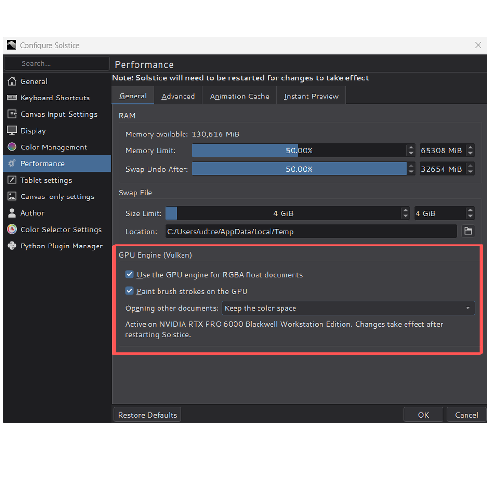
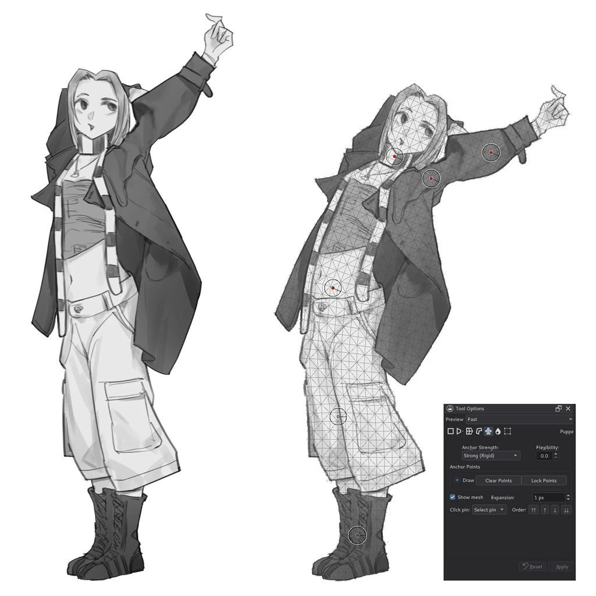
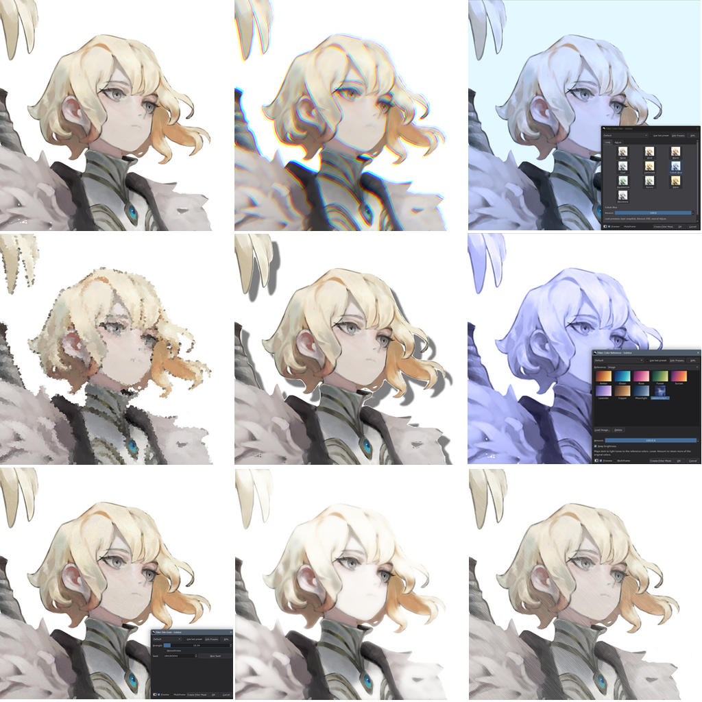
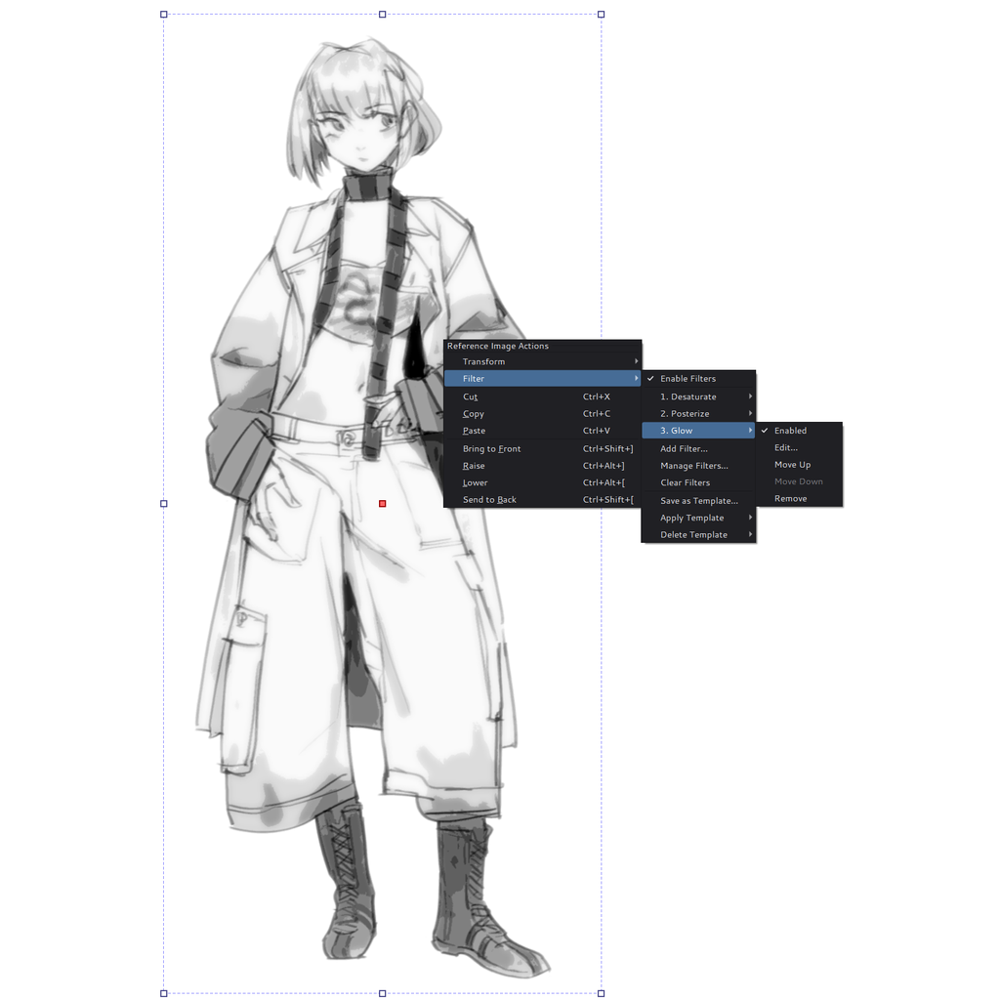
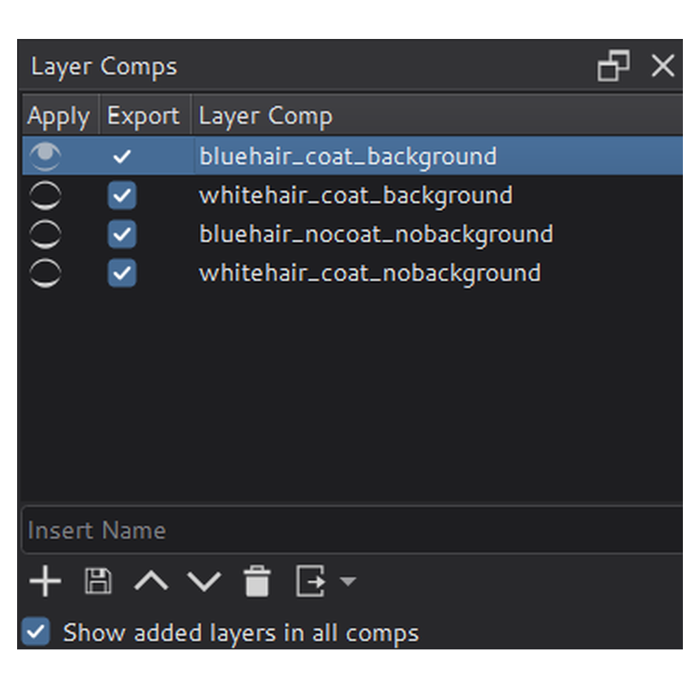
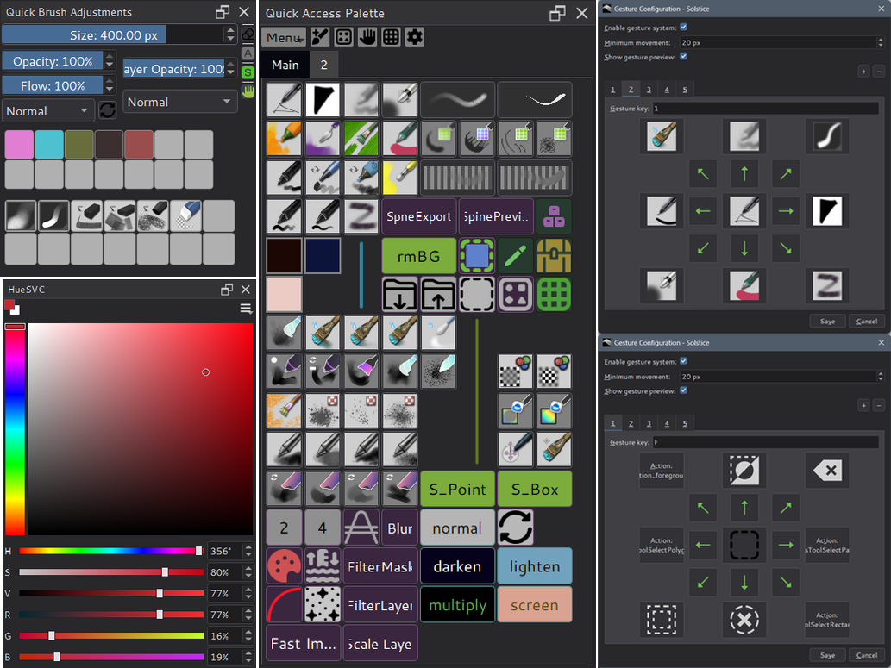
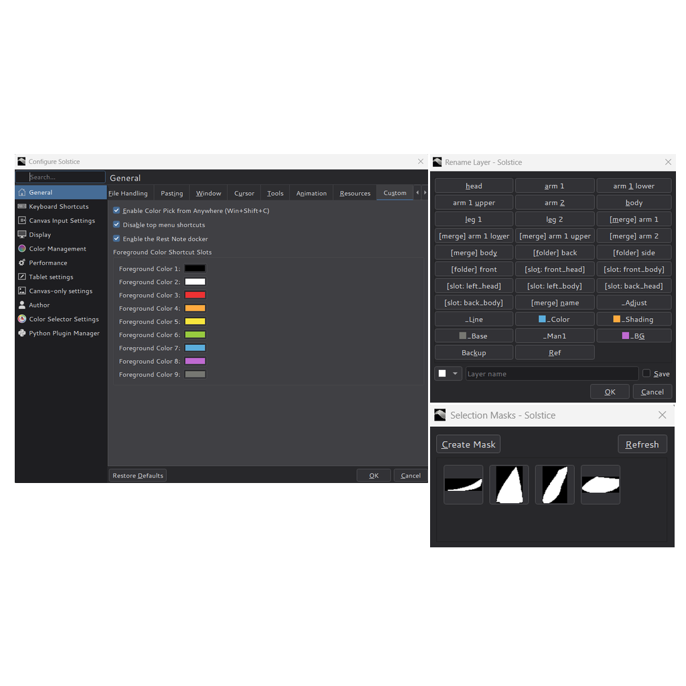
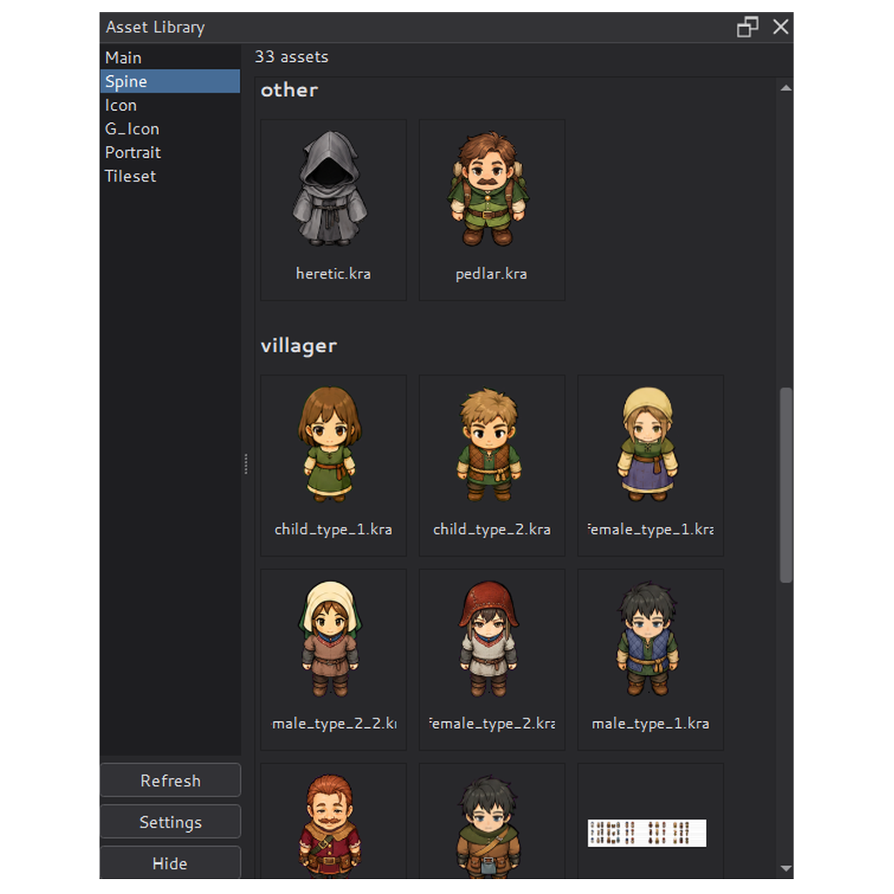
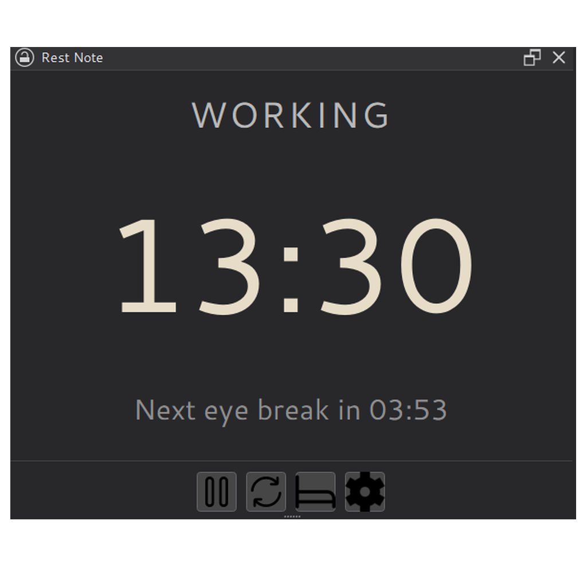
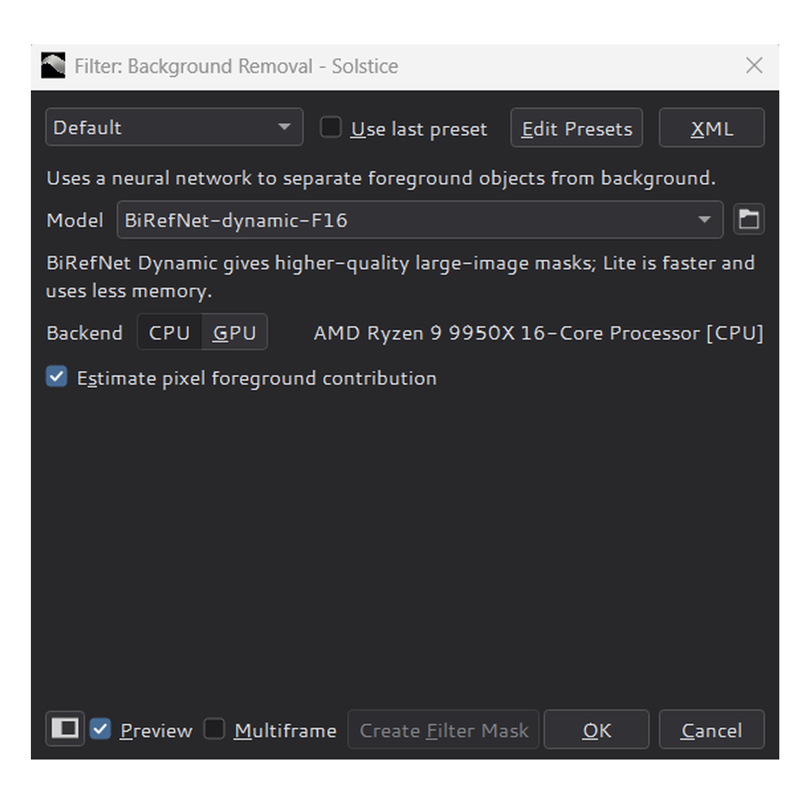

  

---

<b>A GPU-focused digital painting application for Windows, derived from Krita.</b>

## Project page

**Website: <https://solstice.tidalboxstudio.com>**: an overview, the
download page and pages for the main features.

This [GitHub repository](https://github.com/udtren/Solstice) holds the
source code, the releases and the [user guides](docs/README.md); the
[highlights](#highlights) link to individual feature guides.

**Solstice is an open-source digital painting application derived from the
Krita 6 codebase.**

<table>
<tr>
<td width="33%" valign="top">
<h3>⚡ GPU acceleration</h3>

Vulkan-powered layer compositing and canvas updates, and a GPU brush that is on by default: from pen input to the displayed frame, about four times faster than the CPU brush.

</td>
<td width="33%" valign="top">
<h3>🎨 Workflows from Clip Studio Paint</h3>

<a href="docs/puppet-warp.md">Puppet Warp</a> with movable and rotatable pins, eye marks that put brush settings in <a href="docs/brush-editor.md#brush-options-in-tool-options">Tool Options</a>, and a <a href="docs/brush-stroke-layer.md">Brush Stroke Layer</a> that redraws its strokes sharply when scaled, like a vector layer.

</td>
<td width="33%" valign="top">
<h3>🛠️ Krita, refined</h3>

<a href="docs/brush-stroke-preview.md">Brush Presets</a> with stroke previews, filters and grouping, a reworked <a href="docs/brush-editor.md">Brush Editor</a>, <a href="docs/photoshop-brushes.md">Photoshop brush import</a> with presets, textures and folders, <a href="docs/docker-locks.md">docker locks</a>, a live <a href="docs/overview-live-update.md">Overview</a> and a modernized <a href="docs/ui-modernization.md">interface</a>, together with native tools such as <a href="docs/quick-access.md">Quick Access</a> and the <a href="docs/asset-library.md">Asset Library</a>.

</td>
</tr>
</table>

Solstice is independently maintained and desktop-only. It is not an official
Krita edition; upstream Krita changes are adopted selectively as needed. See
[Versions](docs/versioning.md) for its pre-1.0 version numbering.

**Learning Solstice:** for the basics of using the application, see the
[Krita User Manual](https://docs.krita.org/en/user_manual.html). The
features Solstice adds are described in its [user guides](docs/README.md).

## Contents

- [What's new in 0.4.0](#whats-new-in-040)
- [Highlights](#highlights)
  - [New Features](#new-features)
  - [Ported Plugins](#ported-plugins)
  - [Other Major Changes](#other-major-changes)
- [Development and downloads](#development-and-downloads)
- [Differences from Krita](#differences-from-krita)
- [GPU engine](#gpu-engine)
- [Benchmarks](#benchmarks)
- [Supported environment](#supported-environment)
- [Relationship to Krita](#relationship-to-krita)

## What's new in 0.4.0

[Solstice 0.4.0](https://github.com/udtren/Solstice/releases/tag/v0.4.0)
enhances the [Reference Tool](docs/reference-tool.md):

- Non-destructive native filter stacks with editable settings and ordering
- Per-effect and whole-stack enable/disable, removal and undo
- Named templates reusable across reference images and documents
- Illustrated [overview](docs/reference-tool.md) and [filter guide](docs/reference-image-filters.md)

## Highlights

### New Features

<table>
<tr>
<td width="50%" align="center" valign="top">
<a href="docs/gpu-engine.md"> Performance, with the GPU engine and GPU brush options enabled" width="100%"></a>

<b><a href="docs/gpu-engine.md">GPU Engine</a></b> Vulkan layer compositing and a GPU brush, both on by default.

</td>
<td width="50%" align="center" valign="top">

<b><a href="docs/brush-stroke-preview.md">Brush Presets</a></b> Stroke previews, engine and bundle filters, and grouping.

</td>
</tr>
<tr>
<td width="50%" align="center" valign="top">

<b><a href="docs/brush-editor.md#brush-options-in-tool-options">Brush options in Tool Options</a></b> Eye marks put Brush Editor settings in Tool Options.

</td>
<td width="50%" align="center" valign="top">

<b><a href="docs/puppet-warp.md">Puppet Warp</a></b> Repose artwork with movable, rotatable pins in the Transform Tool.

</td>
</tr>
<tr>
<td width="50%" align="center" valign="top">

<b><a href="docs/brush-stroke-layer.md">Brush Stroke Layer</a></b> Strokes are redrawn at the new size when scaled, without blurring.

</td>
<td width="50%" align="center" valign="top">

<b><a href="docs/effects-filters.md">Effects &amp; Color</a></b> New native filters such as Film Grain, Glow and Color Reference.

</td>
</tr>
<tr>
<td width="50%" align="center" valign="top">

<b><a href="docs/reference-tool.md">Reference Tool filters</a></b> Non-destructive filter stacks and templates for reference images.

</td>
<td width="50%" align="center" valign="top">

<b><a href="docs/layer-comps.md">Layer Comps</a></b> Record, apply and export layer visibility states.

</td>
</tr>
</table>

### Ported Plugins

Python plugins reimplemented natively in C++, with no Python installation
required.

<table>
<tr>
<td width="50%" align="center" valign="top">

<b><a href="docs/quick-access.md">Quick Access Manager</a></b> Brush and action palettes, a color selector, brush adjustments and gestures.

</td>
<td width="50%" align="center" valign="top">

<b><a href="docs/lazy-tools.md">Lazy Tools</a></b> Quick layer renaming, selection masks and color shortcuts.

</td>
</tr>
<tr>
<td width="50%" align="center" valign="top">

<b><a href="docs/asset-library.md">Asset Library</a></b> Browse and open your image folders as thumbnails.

</td>
<td width="50%" align="center" valign="top">

<b><a href="docs/rest-note.md">Rest Note</a></b> A work timer with eye-break and break reminders.

</td>
</tr>
<tr>
<td width="50%" align="center" valign="top">

<b><a href="docs/vision-ml.md">Vision Tools</a></b> On-device AI selection, background removal and Smart Fill.

</td>
<td width="50%"></td>
</tr>
</table>

### Other Major Changes

- **[Asset Library on the welcome page](docs/asset-library.md)**: browse and
  open assets from the welcome page before opening a document.
- **[Popup Palette removed](docs/quick-access.md)**: the right-click Popup
  Palette and the On-Canvas Brush Editor are replaced by Quick Access.
- **Native Export Region**: the export feature of the Export Region plugin is
  now built in as **File > Export Region...** (`Alt+Shift+E`), which exports
  the selection or the active layer's bounds.
- **Performance improvements and bug fixes** across the application.

See the [user guides](docs/README.md) for every Solstice feature.

## Development and downloads

> **Experimental software.** The Vulkan engine is on by default and can be
> turned off. It does not yet replace every CPU processing path, and its
> supported hardware and platforms are limited.

Download the unsigned Windows x64 ZIP from
[GitHub Releases](https://github.com/udtren/Solstice/releases/tag/v0.4.0),
extract it and start `solstice.exe`.

Source code and newer Windows x64 trial ZIPs are also available from successful
manual [GitHub Actions builds](https://github.com/udtren/Solstice/actions/workflows/windows-build.yml).
These temporary artifacts expire after seven days and are development builds,
not stable releases. See [Experimental Windows builds](docs/test-builds.md)
for download instructions and packaging limitations. To show `.kra`
thumbnails in Explorer, see [Explorer thumbnails](docs/windows-shell-thumbnails.md).
The application and document icons are described in
[Visual branding](docs/visual-branding.md).

The primary development and default branch is `main`. For source
builds, see the [development environment](AGENTS.md#shared-development-environment) and [build workflow](docs/agent/development-workflow.md#build).
Check the [supported environment](#supported-environment) before building.

## Differences from Krita

Solstice follows its own development direction, centered on an experimental
Vulkan image engine and a separately maintained native feature set. Selected
Python-based extensions have been reimplemented in C++, with compatibility
for existing settings where practical. The Asset Library is also available
from the welcome page, and Puppet Warp is integrated into the Transform Tool.

Android support and its build and packaging infrastructure have been removed.
The right-click Popup Palette and the On-Canvas Brush Editor have been removed
as well.
Solstice does not merge upstream Krita wholesale; upstream changes are
reviewed regularly and adopted selectively as needed. Solstice-specific
changes and support are maintained in this repository.

## GPU engine

The experimental engine uses Vulkan compute on RGBA 32-bit and 16-bit float
documents and shares its data with the OpenGL canvas for display. It is
enabled by default; anything it does not support runs on the CPU as in Krita.
This is an ongoing rewrite, not a fully GPU-based painting pipeline.

What has moved to the GPU so far, and what still runs only on the CPU. The
GPU column applies to RGBA 32-bit and 16-bit float layers only.

| Area | On the GPU | CPU only |
| --- | --- | --- |
| Color spaces | RGBA 32-bit and 16-bit float | Every other color space and depth (8/16-bit integer, CMYK, Lab, grayscale), also as single layers in a float document; file layers |
| Layer compositing | Layer projection, including alpha lock and individual channel locks | Layer styles, Colorize Mask; layers moved by a distance that is not a multiple of 64 pixels |
| Canvas display | Handing the projection to the OpenGL canvas | ANGLE/Direct3D renderer, soft proofing, channel selection in the Channels docker, LUT-based display profiles, absolute colorimetric intent |
| Blend modes | Every mode not listed as CPU only | Dissolve, Marker, Destination In, Destination Atop, Divisive Modulo and its Continuous variants |
| Brush strokes | Pixel brush in Buildup and Wash, with Erase, Alpha Darken, selections, alpha lock and mirror painting | Painting with other brush engines (Color Smudge, Sketch and so on); Alpha Darken with some channels turned off; a single oversized dab |
| Brush tips | Circle, Gaussian and soft auto-brush tips; image tips (predefined and imported Photoshop brushes) as alpha mask, Image Stamp, Lightness Map or Gradient Map | Animated (`.gih`) and text tips; the Sharpness option; Image Stamp with a color profile that does not convert each channel separately |
| Brush textures | Pattern textures | The Lightness and Gradient texture modes |
| Masking brush | Combining the mask with the stroke | Painting the mask itself; the whole masked stroke on GPUs without 64-bit float shader support |
| Transform Tool | Applying Free Transform (scale, rotate, shear), Liquify and Puppet Warp | Perspective, Warp, Cage and Mesh transforms; older Puppet Warp transforms; the preview while editing; combining Puppet Warp's parts; wrap-around mode |
| Filters | Gaussian Blur, also inside Unsharp Mask and Gaussian High Pass, in the Filter dialog, filter layers and filter masks | All other filters; the sharpening step of Unsharp Mask; areas smaller than about 180 x 180 pixels; Instant Preview; wrap-around mode |
| Clone Layers | Copying the source of a Clone Layer moved away from its source | Clone Layers with transparency or filter masks |

Free Transform and Liquify results are identical to the CPU results, pixel
for pixel; so are Puppet Warp's parts, which are then combined on the CPU.
Gaussian Blur matches within one rounding step. Blend modes based on powers,
exponentials or trigonometry match the CPU closely rather than exactly.

The GPU brush can be turned off with **Paint brush strokes on the GPU** next
to the GPU engine option; `KRITA_GPU_BRUSH=1` or `0` overrides the setting.
Batched tile transfers and reusable upload buffers reduce transfer waits,
including for textured and masked brushes. Layer and Wash compositing reuse
completed work buffers and can queue consecutive updates. Whole-tile copies
can retain GPU pixels, and CPU filters, FFT convolution, affine transforms
and layer flips batch their GPU readbacks. Large mirrored brushes with Alpha
Lock can still catch up after pen release; further tuning of that case is
deferred.

See the [GPU Engine guide](docs/gpu-engine.md) for setup and limitations.

## Benchmarks

**These numbers measure specific engine operations, not overall application
performance.** They are not frame rates or pen-to-screen latency measurements.

Measured on October 11, 2026, with an AMD Ryzen 9 9950X and NVIDIA RTX PRO 6000
Blackwell (driver 596.86), using local development builds:

| Workload | CPU | GPU |
| --- | ---: | ---: |
| Resident full layer projection, 4096 x 4096 RGBA32F, 16 layers | 270 ms | 60.6 ms |
| Canvas data preparation, 4096 x 4096 RGBA32F, 8 layers | 1215 ms | 1.81 ms |
| Four mirror passes, 14 dabs of 73 x 73 pixels | 0.949 ms | 0.437 ms |
| Four mirror passes, 32 dabs of 256 x 256 pixels | 51.1 ms | 2.08 ms |
| Transform Tool apply, scale + rotate (bicubic), 2480 x 3508 RGBA32F | 502 ms | 61.5 ms |
| Liquify apply, 20 strokes, 2480 x 3508 RGBA32F | 253 ms | 63.5 ms |
| Gaussian Blur apply, radius 30, 2480 x 3508 RGBA32F | 212 ms | 68.0 ms |
| Puppet Warp apply, 3 pins, 2480 x 3508 RGBA32F | 750 ms | 212 ms |

The affine transform and Liquify results are identical to the CPU results,
pixel for pixel; so are Puppet Warp's parts, which are then combined on the
CPU. The Gaussian Blur results match the CPU results within one rounding
step.

Each value is the median of three fresh-process results, with GPU completion
included and Vulkan validation disabled. Projection and canvas results use
five-sample medians per process; mirror results use five-update averages after
warming all three brush staging slots; transform results are medians of three
calls with a CPU-resident source layer. The Gaussian Blur CPU value splits the
layer into 32 parallel bands, like the Filter dialog's patches; the GPU value
is one call. Projection excludes full CPU readback
(53-57 ms). Canvas preparation starts with GPU-resident projection pixels and
excludes projection work and final OpenGL texture copies. Mirror measurements
include reflection and uploads, compare against serial CPU painting, and
exclude dab generation, scheduling and display.

Completed-stroke measurements from the same day show both the remaining
overhead and workloads that benefit from GPU brushes:

| Queued stroke | CPU only | GPU projection and brush |
| --- | ---: | ---: |
| RGBA32F, 64px Normal Wash | 6.19 ms | 10.88 ms |
| RGBA32F, 256px Normal Buildup | 8.15 ms | 10.70 ms |
| RGBA16F, 128px Soft Light (SVG) Wash, selection and both mirrors | 73.60 ms | 11.46 ms |
| RGBA32F, 300px textured (pattern) Buildup | 53.35 ms | 18.42 ms |
| RGBA32F, 300px textured with a masking brush, Wash | 80.51 ms | 37.45 ms |

These use a 1024 x 1024 document, four layers and 24 queued line segments.
Each value is the median of five-sample medians from three fresh processes.
They include brush generation, final merging and completed projection, but
exclude tablet input and screen presentation. These are different workloads,
not an F16-versus-F32 comparison. Pattern textures and masking brushes are
applied on the GPU since October 10-11, 2026. See the
[measurement details and ranges](docs/agent/wiki/benchmarks/transform-and-filter-costs.md#readme-refresh-2026-10-11).

**Complete short strokes can still be slower on the GPU.** Work-buffer reuse
removed an avoidable wait, but its before/after timing ranges overlap and do
not establish a substantial stroke speedup. Measured from pen input to the
displayed frame instead, the GPU brush is about four times faster (2026-10-10,
see [the input-to-display comparison](docs/gpu-engine.md#input-to-display)).

See the [current benchmark results and limitations](docs/gpu-engine.md#current-benchmarks).
Input-to-display timings are Qt input-to-command-swap measurements, not
physical pen-to-screen latency.
Results vary with workload and hardware and do not establish performance for
a packaged release.

## Supported environment

- **Primary tested platform:** Windows 11, 64-bit desktop.
- **GPU engine target:** NVIDIA Blackwell GPUs (GeForce RTX 50 series and
  RTX PRO Blackwell). Validation and benchmarks use an RTX PRO 6000 Blackwell;
  other GPUs are untested.
- **Graphics APIs:** Vulkan 1.3 and desktop OpenGL with Vulkan/OpenGL external
  memory and semaphore interoperability for the accelerated canvas path.
  ANGLE/Direct3D does not provide that canvas path.
- **Validation setup:** NVIDIA driver 596.86, Qt 6.8 and desktop OpenGL 4.6.
- **Other platforms:** Linux and macOS are not currently validated for this
  custom build. Android is not supported.
- **Interface languages:** English and Simplified Chinese cover everything,
  including Solstice's own features (see [Interface languages](docs/languages.md));
  other languages use Krita's translations, with Solstice's features in
  English.

The GPU engine has narrower requirements than Krita itself.
See the [GPU Engine guide](docs/gpu-engine.md#requirements) for the supported document
formats and fallback behavior.

## Relationship to Krita

**Solstice is not affiliated with, endorsed by, sponsored by, or supported by
the Krita project or KDE.** It is independently maintained and is not an
official Krita edition. Its source-code origins do not imply an organizational
relationship with those projects.

Please report Solstice-specific issues to this repository, not to the Krita
or KDE issue trackers. Credit for the original application belongs to Krita's
contributors. Existing copyright notices and license terms remain applicable;
see [COPYING](COPYING) and the notices in individual files.
