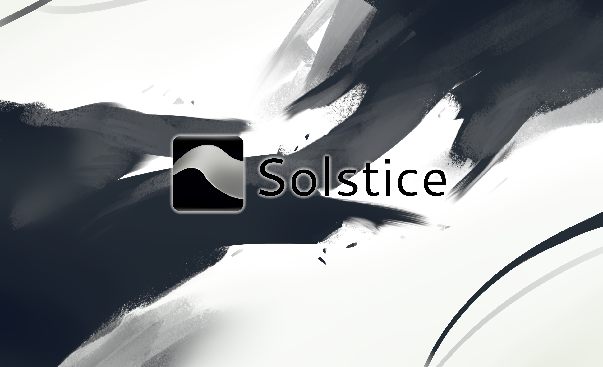
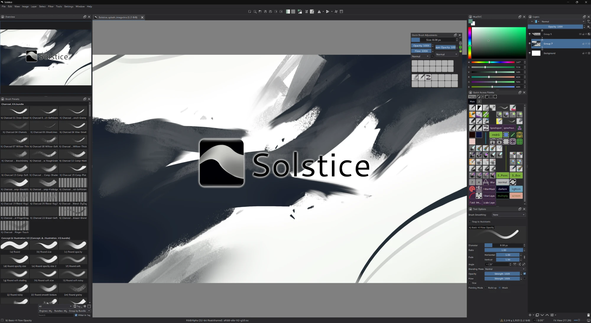
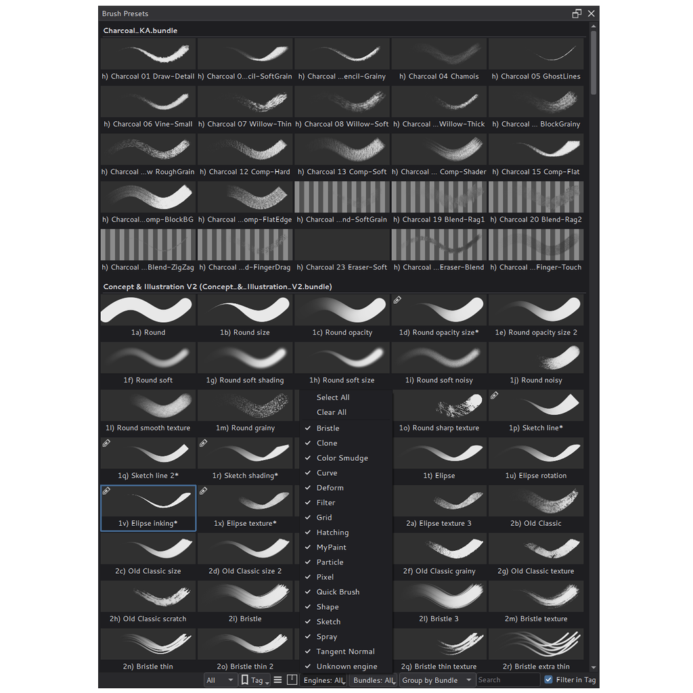
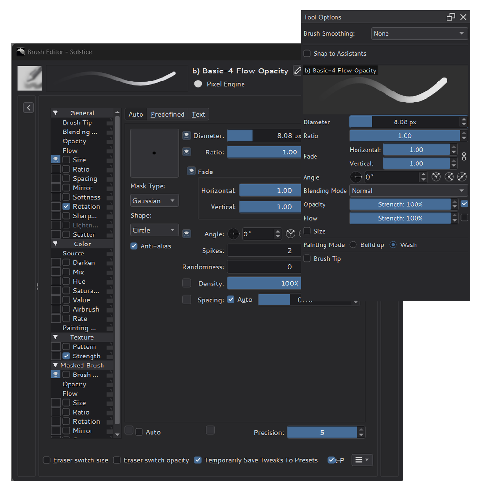
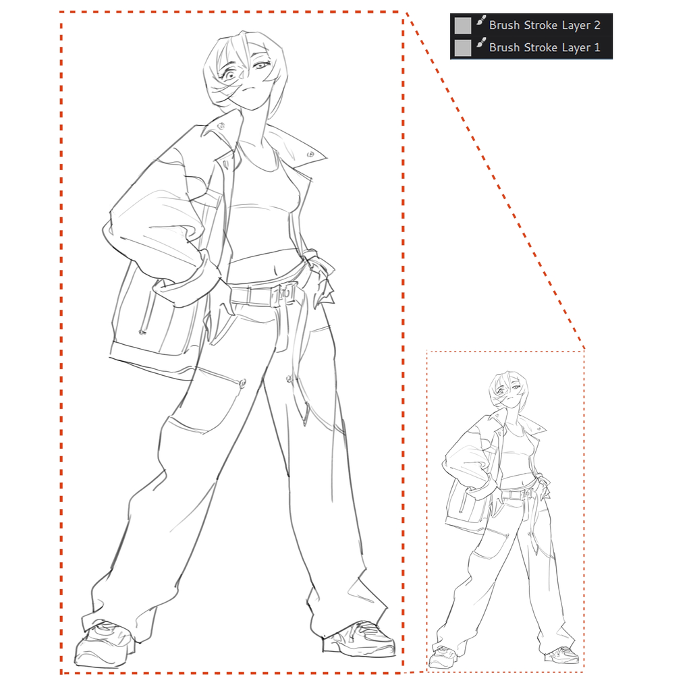

  

---

<b>A GPU-focused digital painting application for Windows, derived from Krita.</b>

**Solstice is an open-source digital painting application derived from the
Krita 6 codebase.**

<table>
<tr>
<td width="33%" valign="top">
<h3>⚡ GPU acceleration</h3>

Vulkan-powered layer compositing and canvas updates, and a GPU brush that is on by default: from pen input to the displayed frame, about four times faster than the CPU brush.

</td>
<td width="33%" valign="top">
<h3>🎨 Workflows from Clip Studio Paint</h3>

<a href="docs/puppet-warp.md">Puppet Warp</a> with movable and rotatable pins, eye marks that put brush settings in <a href="docs/brush-editor.md#brush-options-in-tool-options">Tool Options</a>, and a <a href="docs/brush-stroke-layer.md">Brush Stroke Layer</a> that redraws its strokes sharply when scaled, like a vector layer.

</td>
<td width="33%" valign="top">
<h3>🛠️ Krita, refined</h3>

<a href="docs/brush-stroke-preview.md">Brush Presets</a> with stroke previews, filters and grouping, a reworked <a href="docs/brush-editor.md">Brush Editor</a>, <a href="docs/photoshop-brushes.md">Photoshop brush import</a> with presets, textures and folders, <a href="docs/docker-locks.md">docker locks</a>, a live <a href="docs/overview-live-update.md">Overview</a> and a modernized <a href="docs/ui-modernization.md">interface</a>, together with native tools such as <a href="docs/quick-access.md">Quick Access</a> and the <a href="docs/asset-library.md">Asset Library</a>.

</td>
</tr>
</table>

Solstice is independently maintained and desktop-only. It is not an official
Krita edition, and development no longer tracks upstream Krita. It is in
testing; see [Versions](docs/versioning.md) for the version numbering.

**Learning Solstice:** for the basics of using the application, see the
[Krita User Manual](https://docs.krita.org/en/user_manual.html). The
features Solstice adds are described in its [user guides](docs/README.md).

[In development](#in-development) | [Highlights](#highlights) | [Screenshots](#screenshots) | [Development & downloads](#development-and-downloads) | [GPU engine](#gpu-engine) | [Benchmarks](#benchmarks) | [Supported environment](#supported-environment)

## In development

The following additions are in development and have not yet been published
in a release:

- **[Effects & Color](docs/effects-filters.md)**: illustration filters for
  color, lighting, texture and line-art extraction, plus extended Lens Blur.
- **[Color Reference](docs/effects-filters.md#color-reference)**: recolor
  from an image or gradient, with drag-and-drop image import.
- **[Layer Comps](docs/layer-comps.md)**: save, switch and export layer
  visibility variations.

See [GitHub Releases](https://github.com/udtren/Solstice/releases) for
published versions and their release notes.

## Highlights

- **[Experimental Vulkan engine](docs/gpu-engine.md)**: GPU-resident image
  tiles, accelerated layer compositing and canvas data preparation.
- **[GPU brush](docs/gpu-engine.md)**: on by default; pixel brushes on RGBA
  32-bit and 16-bit float layers composite nearly every blend mode on the GPU
  in Buildup and Wash, with selections, alpha lock and mirror painting. In a
  hand-drawn comparison, input to display took about 5 ms, against 18–22 ms
  with the CPU brush.
- **Native productivity tools**: [Quick Access Manager](docs/quick-access.md),
  [Asset Library](docs/asset-library.md), [Rest Note](docs/rest-note.md) and
  [Lazy Tools](docs/lazy-tools.md).
- **[Effects & Color](docs/effects-filters.md)**.
- **[G'MIC-Qt CPU filters](docs/gmic.md)**.
- **[Layer Comps](docs/layer-comps.md)**.
- **[Vision ML](docs/vision-ml.md)**: native tools for AI-assisted selection,
  background removal and Smart Fill.
- **[Puppet Warp](docs/puppet-warp.md)**: pose and reshape artwork with movable
  and rotatable pins in the Transform Tool.
- **[Docker locks](docs/docker-locks.md)**: lock the widths and heights of
  docked dockers.
- **[Settings folder](docs/settings-folder.md)**: Solstice keeps its
  settings and resources in `%APPDATA%\Solstice`, separate from Krita, and can
  import a Krita profile on the first start.
- **[Overview live update](docs/overview-live-update.md)**: the Overview
  docker follows the canvas while painting.
- **[Solstice interface](docs/ui-modernization.md)**: the bundled Cantarell UI
  font, an optional Solstice Dark theme, refined docker titles, document tabs
  and toolbars, and a flat Solstice widget style.
- **[Brush Presets](docs/brush-stroke-preview.md)**: cached stroke previews in
  a grid that adapts to the docker's width, with multi-select engine and bundle
  filters alongside tags and search, and optional grouping by engine or
  bundle.
- **[Brush Editor](docs/brush-editor.md)**: the options of every brush
  engine live in a shared model, so one change updates only that option in
  the preset.
- **[Brush options in Tool Options](docs/brush-editor.md#brush-options-in-tool-options)**:
  as with Clip Studio Paint's eye marks, an eye next to a Brush Editor
  setting shows it in the Tool Options docker, under the current brush's
  stroke preview.
- **[Brush Stroke Layer](docs/brush-stroke-layer.md)**: a paint layer that
  remembers its brush strokes; scaling the image or layer, or transforming it
  with the Transform Tool, redraws them at the new size, so small line art
  enlarges without blurring. The strokes are saved in `.kra`, and Krita opens
  the layer as a paint layer.
- **[Photoshop brushes](docs/photoshop-brushes.md)**: an `.abr` file is
  imported like a bundle, with its brush tips, patterns and brush presets
  (converted to Pixel Brush presets, with their dynamics, texture, dual
  brush and color dynamics) and its Brushes panel folders as tags.

## Screenshots

The Brush Presets docker grouped by bundle, with the Engines filter open. See
the [Brush Presets guide](docs/brush-stroke-preview.md) for preview behavior,
filters and grouping.

Eyes in the Brush Editor choose the settings that the Tool Options docker
shows in its Brush section. See
[Brush options in Tool Options](docs/brush-editor.md#brush-options-in-tool-options).

A figure sketch on a Brush Stroke Layer and a copy of it enlarged with
Image > Scale Image: the strokes are drawn again at the new size instead of
being resampled. See the [Brush Stroke Layer guide](docs/brush-stroke-layer.md).

A figure reposed with Puppet Warp in the Transform Tool: pins on the mesh
move and rotate the parts around them. See the
[Puppet Warp guide](docs/puppet-warp.md).

## Development and downloads

> **Experimental software.** The Vulkan engine is on by default and can be
> turned off. It does not yet replace every CPU processing path, and its
> supported hardware and platforms are limited.

Solstice is available as source code and as unsigned Windows x64 trial ZIPs
from successful manual [GitHub Actions builds](https://github.com/udtren/Solstice/actions/workflows/windows-build.yml).
These temporary artifacts expire after seven days and are development builds,
not stable releases. See [Experimental Windows builds](docs/test-builds.md)
for download instructions and packaging limitations. To show `.kra`
thumbnails in Explorer, see [Explorer thumbnails](docs/windows-shell-thumbnails.md).
The application and document icons are described in
[Visual branding](docs/visual-branding.md).

The primary development and default branch is `main`. For source
builds, see the [development environment](AGENTS.md#shared-development-environment) and [build workflow](docs/agent/development-workflow.md#build).
Check the [supported environment](#supported-environment) before building.

## Project page

**Website: <https://solstice.tidalboxstudio.com>**: an overview, the
download page and pages for the main features.

This [GitHub repository](https://github.com/udtren/Solstice) holds the
source code, the releases and the [user guides](docs/README.md); the
[highlights](#highlights) link to individual feature guides.

## Differences from Krita

Solstice follows its own development direction, centered on an experimental
Vulkan image engine and a separately maintained native feature set. Selected
Python-based extensions have been reimplemented in C++, with compatibility
for existing settings where practical. The Asset Library is also available
from the welcome page, and Puppet Warp is integrated into the Transform Tool.

Android support and its build and packaging infrastructure have been removed.
The right-click Popup Palette and the On-Canvas Brush Editor have been removed
as well; [Quick Access](docs/quick-access.md) provides a color selector, a
brush grid and brush adjustments instead, and the tools' right-click menus
remain.
Upstream Krita synchronization has been discontinued; Solstice-specific
changes and support are maintained in this repository.

## GPU engine

The experimental engine uses Vulkan compute for supported RGBA floating-point
layer compositing in RGBA32F and RGBA16F and shares data with the OpenGL canvas
for display. Supported layer modes include Normal, Multiply, Screen, Overlay,
Soft Light and the HSY, HSL, HSV and HSI color modes; every blend mode runs
on the GPU except Dissolve, Marker, Destination In/Atop and Divisive Modulo
(and its Continuous variants), including individual channel locks. It is
enabled by default and falls back to CPU paths for unsupported operations.

The GPU pixel brush (on by default) also composites the same blend modes,
Erase and Alpha Darken on the GPU, with selections, alpha lock and mirror
painting. Supported Buildup strokes and Wash
previews and final merges use GPU paths with CPU-compatible channel handling.
RGBA16F brushes support the same modes in Buildup and Wash, including Wash's
Alpha Darken painting buffer. Blend modes without a GPU version retain CPU
fallback.
Batched tile transfers and reusable upload buffers reduce transfer waits,
including for textured and masked brushes. Layer and Wash compositing reuse
completed work buffers and can queue consecutive updates. Whole-tile copies
can retain GPU pixels, and CPU filters, FFT convolution, affine transforms
and layer flips now batch their GPU readbacks.

The GPU brush can be turned off with **Paint brush strokes on the GPU** next
to the GPU engine option; `KRITA_GPU_BRUSH=1` or `0` overrides the setting. On RGBA32F
and RGBA16F layers, circle, Gaussian and soft auto-brush dabs, image-based brush tips (also as
colour stamps, Lightness or Gradient maps) and their pattern textures are
also computed on the GPU, and so is the masking brush composite. The masking brush's
own mask, most filter calculations and most transform
calculations still run on the CPU; the Transform Tool's
affine transforms, Liquify, Puppet Warp and Gaussian Blur (also inside
Unsharp Mask and Gaussian High Pass) are applied on the GPU for float layers. Large mirrored brushes with
Alpha Lock can still catch up after pen release; further tuning of that case
is deferred. This is an ongoing rewrite, not a fully GPU-based painting pipeline.

See the [GPU Engine guide](docs/gpu-engine.md) for setup and limitations.

## Benchmarks

**These numbers measure specific engine operations, not overall application
performance.** They are not frame rates or pen-to-screen latency measurements.

Measured on October 11, 2026, with an AMD Ryzen 9 9950X and NVIDIA RTX PRO 6000
Blackwell (driver 596.86), using local development builds:

| Workload | CPU | GPU |
| --- | ---: | ---: |
| Resident full layer projection, 4096 x 4096 RGBA32F, 16 layers | 270 ms | 60.6 ms |
| Canvas data preparation, 4096 x 4096 RGBA32F, 8 layers | 1215 ms | 1.81 ms |
| Four mirror passes, 14 dabs of 73 x 73 pixels | 0.949 ms | 0.437 ms |
| Four mirror passes, 32 dabs of 256 x 256 pixels | 51.1 ms | 2.08 ms |
| Transform Tool apply, scale + rotate (bicubic), 2480 x 3508 RGBA32F | 502 ms | 61.5 ms |
| Liquify apply, 20 strokes, 2480 x 3508 RGBA32F | 253 ms | 63.5 ms |
| Gaussian Blur apply, radius 30, 2480 x 3508 RGBA32F | 212 ms | 68.0 ms |
| Puppet Warp apply, 3 pins, 2480 x 3508 RGBA32F | 750 ms | 212 ms |

The affine transform and Liquify results are identical to the CPU results,
pixel for pixel; so are Puppet Warp's parts, which are then combined on the
CPU. The Gaussian Blur results match the CPU results within one rounding
step.

Each value is the median of three fresh-process results, with GPU completion
included and Vulkan validation disabled. Projection and canvas results use
five-sample medians per process; mirror results use five-update averages after
warming all three brush staging slots; transform results are medians of three
calls with a CPU-resident source layer. The Gaussian Blur CPU value splits the
layer into 32 parallel bands, like the Filter dialog's patches; the GPU value
is one call. Projection excludes full CPU readback
(53-57 ms). Canvas preparation starts with GPU-resident projection pixels and
excludes projection work and final OpenGL texture copies. Mirror measurements
include reflection and uploads, compare against serial CPU painting, and
exclude dab generation, scheduling and display.

Completed-stroke measurements from the same day show both the remaining
overhead and workloads that benefit from GPU brushes:

| Queued stroke | CPU only | GPU projection and brush |
| --- | ---: | ---: |
| RGBA32F, 64px Normal Wash | 6.19 ms | 10.88 ms |
| RGBA32F, 256px Normal Buildup | 8.15 ms | 10.70 ms |
| RGBA16F, 128px Soft Light (SVG) Wash, selection and both mirrors | 73.60 ms | 11.46 ms |
| RGBA32F, 300px textured (pattern) Buildup | 53.35 ms | 18.42 ms |
| RGBA32F, 300px textured with a masking brush, Wash | 80.51 ms | 37.45 ms |

These use a 1024 x 1024 document, four layers and 24 queued line segments.
Each value is the median of five-sample medians from three fresh processes.
They include brush generation, final merging and completed projection, but
exclude tablet input and screen presentation. These are different workloads,
not an F16-versus-F32 comparison. Pattern textures and masking brushes are
applied on the GPU since October 10-11, 2026. See the
[measurement details and ranges](docs/agent/wiki/benchmarks/transform-and-filter-costs.md#readme-refresh-2026-10-11).

**Complete short strokes can still be slower on the GPU.** Work-buffer reuse
removed an avoidable wait, but its before/after timing ranges overlap and do
not establish a substantial stroke speedup. Measured from pen input to the
displayed frame instead, the GPU brush is about four times faster (2026-10-10,
see [the input-to-display comparison](docs/gpu-engine.md#input-to-display)).

See the [current benchmark results and limitations](docs/gpu-engine.md#current-benchmarks).
Input-to-display timings are Qt input-to-command-swap measurements, not
physical pen-to-screen latency.
Results vary with workload and hardware and do not establish performance for
a packaged release.

## Supported environment

- **Primary tested platform:** Windows 11, 64-bit desktop.
- **GPU engine target:** NVIDIA Blackwell GPUs (GeForce RTX 50 series and
  RTX PRO Blackwell). Validation and benchmarks use an RTX PRO 6000 Blackwell;
  other GPUs are untested.
- **Graphics APIs:** Vulkan 1.3 and desktop OpenGL with Vulkan/OpenGL external
  memory and semaphore interoperability for the accelerated canvas path.
  ANGLE/Direct3D does not provide that canvas path.
- **Validation setup:** NVIDIA driver 596.86, Qt 6.8 and desktop OpenGL 4.6.
- **Other platforms:** Linux and macOS are not currently validated for this
  custom build. Android is not supported.

The GPU engine has narrower requirements than Krita itself.
See the [GPU Engine guide](docs/gpu-engine.md#requirements) for the supported document
formats and fallback behavior.

## Relationship to Krita

**Solstice is not affiliated with, endorsed by, sponsored by, or supported by
the Krita project or KDE.** It is independently maintained and is not an
official Krita edition. Its source-code origins do not imply an organizational
relationship with those projects.

Please report Solstice-specific issues to this repository, not to the Krita
or KDE issue trackers. Credit for the original application belongs to Krita's
contributors. Existing copyright notices and license terms remain applicable;
see [COPYING](COPYING) and the notices in individual files.
