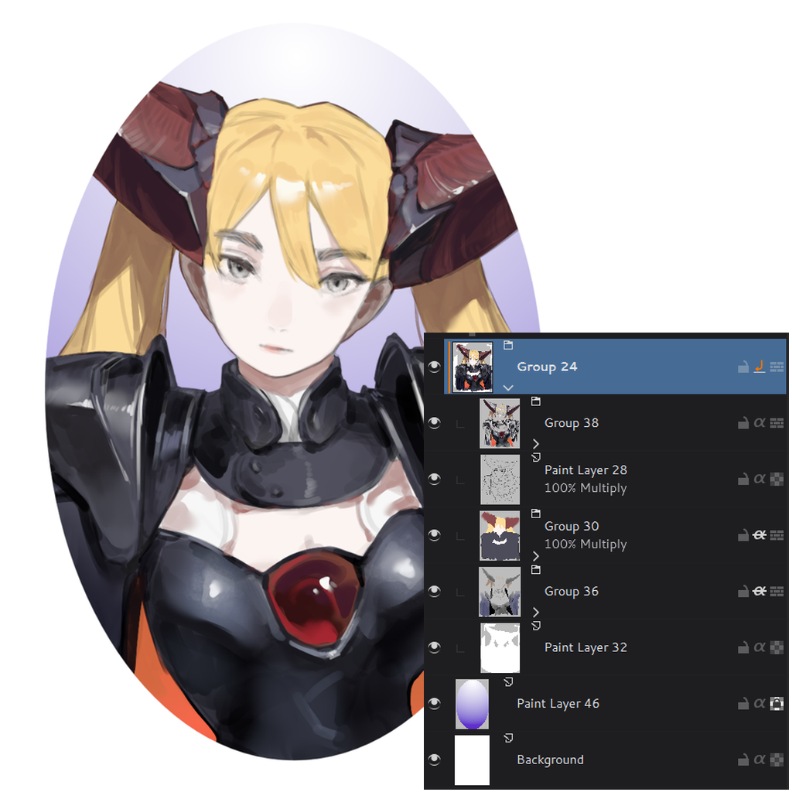

# Clipping Mask

A clipped layer shows only where the layer directly below it has pixels,
as in Photoshop, Clip Studio Paint and SAI. You do not need a group, and
the layer you clip to keeps its name.

Added in [0.6.0](https://github.com/udtren/Solstice/releases/tag/v0.6.0).

## Clipping a layer

- **New Clipping Layer**: adds a paint layer above the active layer and clips
  it to that layer. It is in the Layers docker's context menu under
  **Group**, and you can give it a shortcut in **Settings > Configure
  Solstice > Keyboard Shortcuts**.
- **Alt+click** the inherit alpha icon of a layer row to clip or unclip that
  layer. The icon then shows an orange arrow, and an orange bar beside the
  thumbnail marks the clipped layer.
- **Toggle Clipping Mask**: clips or unclips the selected layers. It is in
  the context menu under **Toggle Locks & Visibility**.

All of these can be undone.

## How clipping works

- The layer you clip to is the *base*. It is the nearest layer below that is
  not clipped itself. Several clipped layers in a row all clip to the same
  base.
- A paint layer, a group or any other layer can be a base. A pass-through
  group cannot be a base, and layers inside a pass-through group are not
  clipped.
- Each clipped layer keeps its own blend mode and opacity. The base's blend
  mode and opacity apply to the base and all of its clipped layers together.
- Hiding the base also hides its clipped layers. A transparency mask on the
  base also clips the layers above it.
- A clipped layer with nothing below it is shown normally.
- A layer cannot use clipping and inherit alpha at the same time: switching
  one on switches the other off. Inherit alpha works as before.

## Baking clipped layers

**Merge Down** (Ctrl+E) on a clipped layer merges it into its base. The
result keeps the base's name, blend mode and opacity, and looks the same as
before. Merging two clipped layers gives one clipped layer.

**Merge Selected** with a base and its clipped layers selected merges the
base and the clipped layers as they look together. Merging only clipped
layers gives one clipped layer. Clipped layers merged without their base are
merged as if unclipped. As with any merge in Solstice, blend modes other
than Normal and opacity below 100% may look different after merging.
**Flatten Image** and **Flatten Layer** keep how clipped layers look.

## Files

- `.kra` files keep clipping. Krita itself ignores it and shows clipped
  layers unclipped.
- PSD files keep clipping in both directions: Photoshop's clipped layers
  open as clipped layers, and clipped layers are saved as Photoshop's
  clipping. Photoshop ignores a clipped group.

## Current limitations

- A layer style on the base applies only to the base, not to its clipped
  layers.
- Copy, Destination In and Destination Atop are not supported as the base's
  blend mode.

Technical notes are in the [agent plan](agent/clipping-mask-plan.md).
