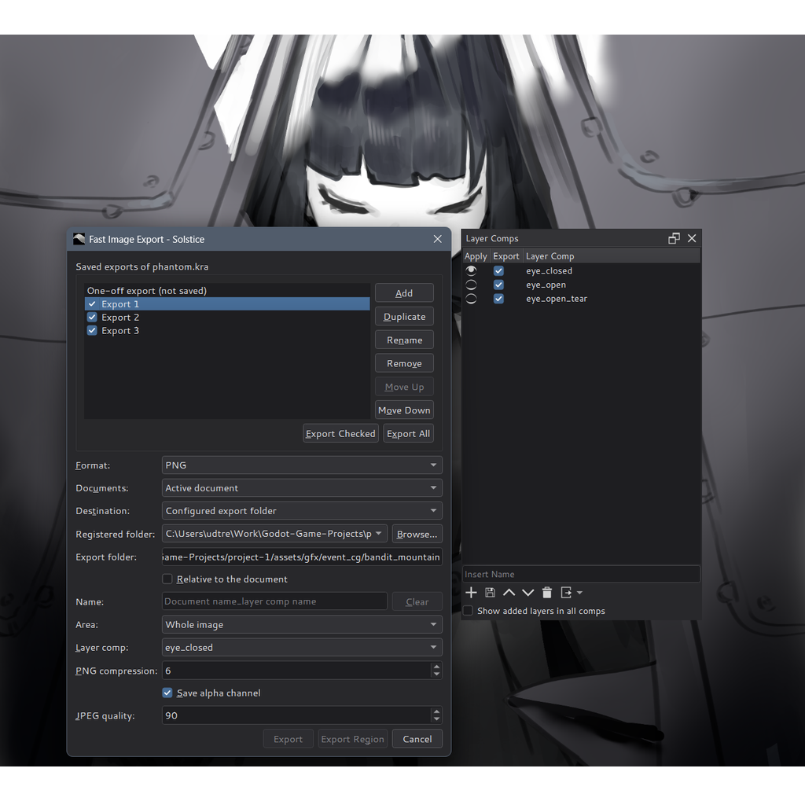

# Layer Comps

Layer Comps extends the former Compositions docker. Open it from
**Settings > Dockers > Layer Comps**. Existing workspaces, compositions and
Update/Rename shortcuts continue to work.

Resizing expands the list and name field. The action buttons remain grouped
at the left, and extra height goes to the list.

## Record and apply

1. Arrange layer visibility in the Layers docker.
2. Enter a name and click **Add**. An empty name gets a number automatically.
3. Repeat for each variation.
4. Click a comp's eye, or use the previous/next buttons, to apply it. With
   the list focused, Up/Down also applies the row you move to.
   Previous/Next stop at the ends.

The eye indicates a comp whose recorded visibility matches the current
layers. Manual visibility changes clear it unless they match another comp.
Applying different visibility is one Undo step. Group expansion is restored
too, but is not part of Undo or the eye's matching rule.

## Keep a custom state

When you apply a comp from a custom visibility state, **Last Layer Display
State** appears at the top. Apply it to restore that custom state. Switching
between saved comps does not replace it. A later custom state replaces it
when you apply another comp.

This entry is shared between views of the same document. It cannot be
renamed, reordered, overwritten or exported, and is not saved to disk.
Layers created after the snapshot retain their current visibility when it
is restored; layers that no longer exist are ignored.

## Manage comps

- Ctrl/Shift-click names to select several rows. Shift+Up/Down extends the
  selection without applying. The **Export** checkbox selects export targets,
  independently of row selection.
- Drag selected rows to reorder them. Non-adjacent selections move as a
  block in their existing order.
- **Overwrite** records the current layer state into all selected comps.
  **Delete** removes all selected comps. Multiple-item operations request
  confirmation.
- Double-click a comp's name, or press F2, to rename it in place; press
  Enter to keep the new name or Esc to cancel. An empty name keeps the old
  one. The context menu's **Rename Composition** renames the current comp in
  a dialog; **Update Composition** overwrites selected comps. Last Layer
  Display State cannot be renamed; double-clicking it applies it.

These list edits are saved with the document but are not undoable.

## Newly added layers

**Show added layers in all comps** controls how layers added afterwards are
recorded in existing comps. It includes the children of added groups.
It changes their saved visibility, not the visibility of the newly added
layer on the canvas. Existing records are retained when a layer is moved,
or its deletion is undone.

The setting is on for new documents. Older .kra files load with it off,
preserving their former behavior. The setting is saved even if the document
has no comps yet. Changing it does not rewrite existing records.

## Export and limitations

Use the export button or its menu for the existing PNG image and animation
exports. Only checked comps are exported. Export restores the open image's
previous state and does not replace Last Layer Display State. PNG export
still blocks the interface and cannot be canceled.

To give each comp its own export settings (PNG or JPEG, folder, file name,
whole image or selection), use the saved exports of **Fast Image Export** and
choose the comp in their **Layer comp** setting; see
[Lazy Tools: Layer comps](lazy-tools.md#layer-comps). Those exports run on a
copy of the image, so the canvas does not change. The **Export** checkboxes
here do not select saved exports.

Each comp has a hidden id, saved in the `.kra`, by which saved exports find it
after a rename. Krita and older Solstice versions drop the id when they save
the file; saved exports then find a comp by its name, as long as only one
comp has that name.

Comps store visibility and group expansion, not opacity, blend modes,
position or pixel contents. PSD layer-comp import/export is not supported.
The .kra records remain readable by Krita; the additional new-layer policy
is specific to Solstice and may be lost when resaving in another application.
