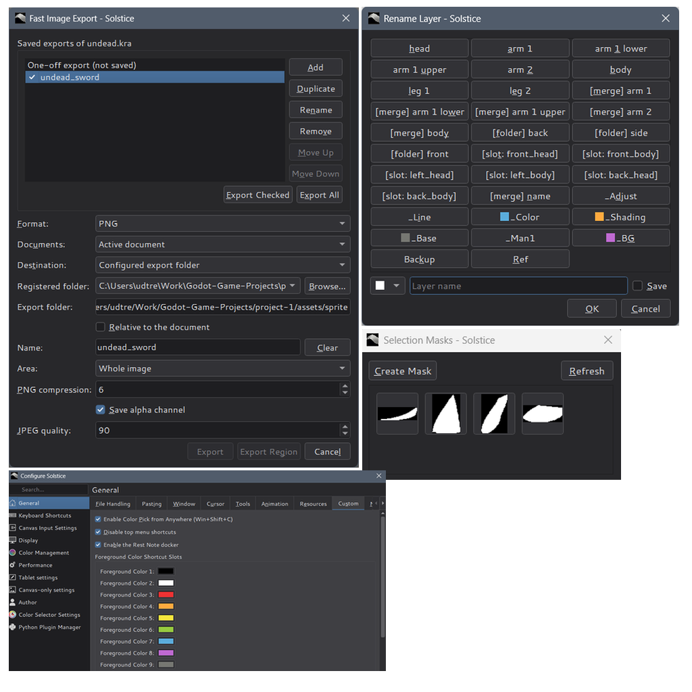
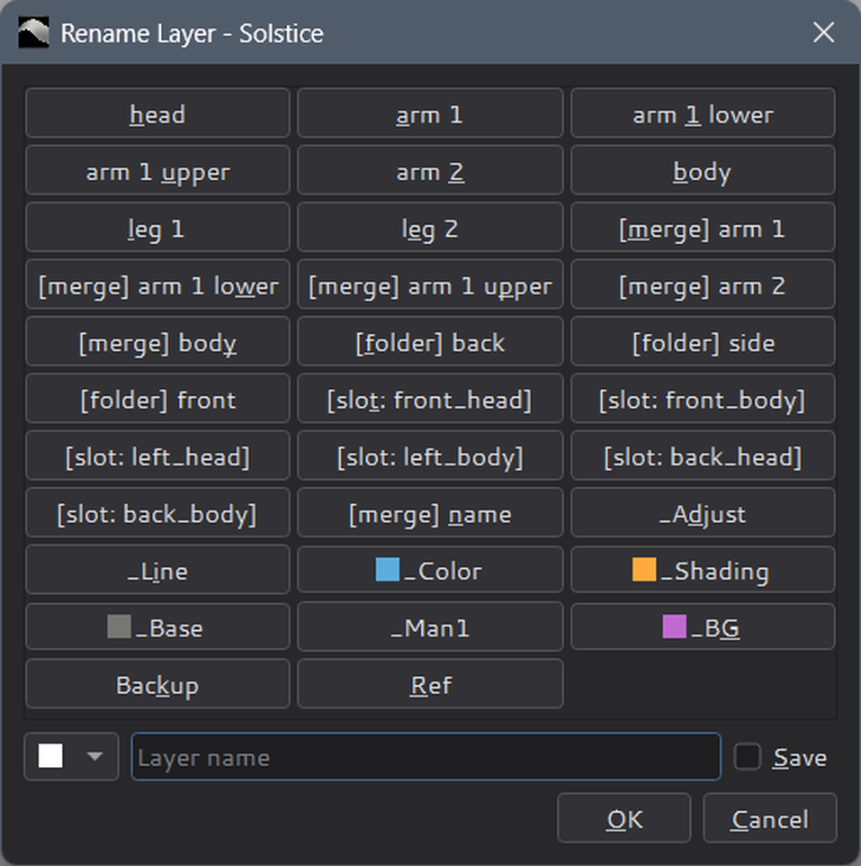
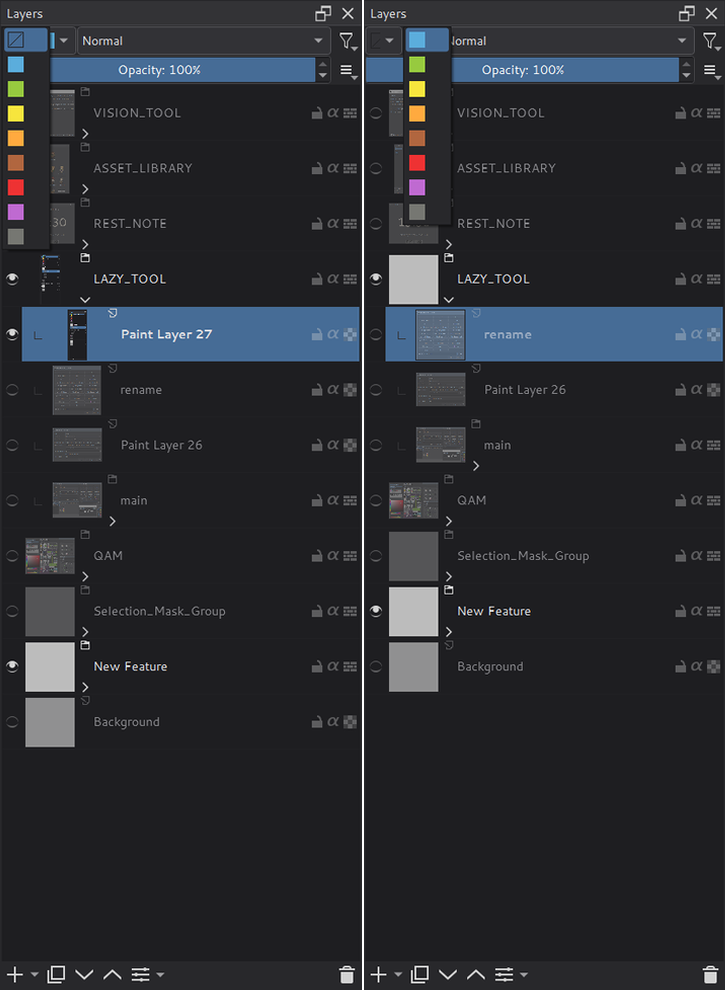
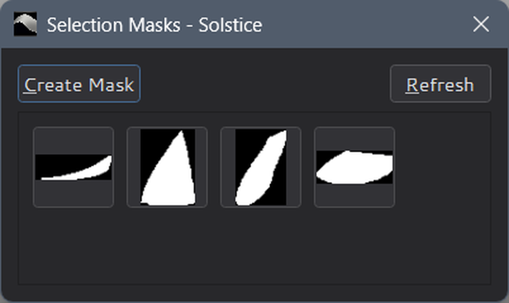
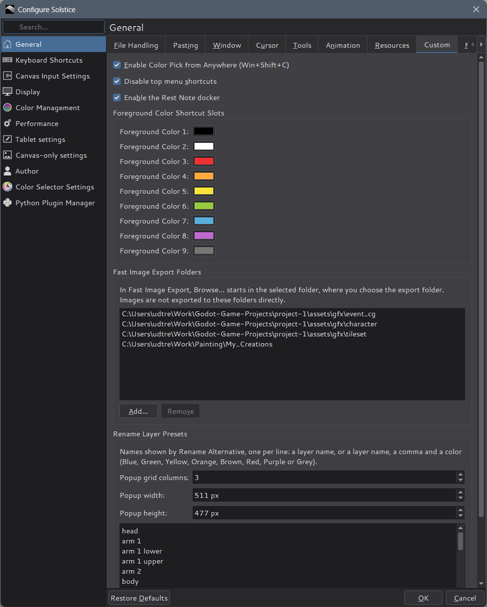

# Lazy Tools

Solstice includes native versions of the core productivity features from the
Lazy Tools Python plugin: fast PNG/JPEG export with saved export settings per
document, a preset-based rename dialog, layer color labels, saved selections,
foreground color shortcuts and a system-wide color picker. No separate Lazy
Tools docker or Python installation is required.

For the original, see the plugin repository, [Lazy
Tools](https://github.com/udtren/krita-lazy-tools). This guide covers
Solstice's native version and where it differs.

The dialogs open from actions without default shortcuts. Assign them under
**Settings > Configure Solstice > Keyboard Shortcuts**: search for
**Fast Image Export**, **Rename Alternative**, **Create Selection Mask
Alternative**, **Create Selection Mask Popup** or **Set Foreground Color**.

## Fast Image Export

![The Fast Image Export dialog for phantom.kra: Export 2 of three checked saved exports is selected below One-off export (not saved), beside Add, Duplicate, Rename, Remove, Move Up, Move Down, Export Checked and Export All; below the list are Format, Documents, Destination set to Configured export folder, Registered folder, Export folder, Relative to the document, an empty Name showing Document name_layer comp name, Area, Layer comp set to eye_open, the PNG and JPEG options, and the Export, Export Region and Cancel buttons](images/lazy_tool/fast_image_export.png)

**Fast Image Export** saves PNG or JPEG copies without changing the document's
file name or saved state. Export once with the settings in the dialog, or
keep several export settings in the document and run them together: see
[Saved exports](#saved-exports). The settings below are those of a one-off
export.

- **Format:** PNG or JPEG.
- **Documents:** the active document or all open documents.
- **Destination:** the configured **Export folder** (the default), the
  document's own folder, or a folder chosen when you press **Export**. The
  dialog keeps your last choice: it opens with it next time, even if you
  closed the dialog without exporting.
- **PNG compression**, **Save alpha channel** and **JPEG quality** set the
  format options.

Documents must already have a file name; unsaved documents are skipped and
listed. PNG and JPEG options and the export folder are remembered between
uses. The format's own export options dialog can still appear, as for
File > Export. Its other options, such as **Force convert to sRGB**, keep the
values last used for that format, here or in File > Export; Fast Image
Export's PNG compression, alpha and JPEG quality are applied on top.

### Name

**Name** is optional. Leave it empty to name the image after the document
(`painting.kra` becomes `painting.png`), or type a file name without the
extension to export under that name instead; **Clear** empties the field. A
typed `.png`, `.jpg` or `.jpeg` ending is ignored, and names containing
`\ / : * ? " < > |` or ending with a dot or a space are refused. The name is
used only for the active document: it is unavailable while **Documents** is
**All open documents**. It is not remembered after the dialog closes. An
existing file with the same name is replaced, as with the default name.

### Saved exports

A document can keep several export settings of its own, for example a PNG
into a game project's sprite folder and a JPEG for the web. They appear at the
top of the dialog under **Saved exports of** *document*. The first row,
**One-off export (not saved)**, is the dialog as described above: select it to
export once with **Export** or **Export Region**. Those two buttons are
unavailable while a saved export is selected; run saved exports with
**Export Checked** or **Export All** instead.

- **Add** saves the settings below the list as a new saved export of the
  document and lets you type its name. **Duplicate**, **Rename**, **Remove**,
  **Move Up** and **Move Down** act on the selected one; double-click a name to
  rename it too.
- While a saved export is selected, the settings below edit it, and changes
  are kept at once: **Format**, PNG compression, alpha and JPEG quality,
  **Destination** (the document's folder or a folder; a folder cannot be
  chosen each time), **Export folder**, **Name** (empty uses the document's
  name), and **Area**: the whole image, or the area selected when the export
  runs. **Relative to the document** stores the folder relative to the
  document's folder, so it still works after you move the document together
  with that folder, for example a whole game project. **Layer comp** exports
  the image as one of the document's [Layer Comps](layer-comps.md) shows it;
  see [Layer comps](#layer-comps).
- The checkbox of each saved export marks it for **Export Checked**;
  **Export All** runs every saved export. With **Documents** set to **All
  open documents**, each open document runs its own saved exports, and
  documents without them are listed as skipped.

Saved exports run without the format's options dialog: each keeps the
format's other options, such as **Force convert to sRGB**, as they were for
that format when you added it or changed its format. Before writing, the run
checks that no two saved exports write the same file; if they would, nothing
is exported. As with **Export**, an existing file is replaced, a missing
folder is not created, and a saved export of the selected area is skipped
while nothing is selected; the others still run. Skipped exports are listed
with the reason.

Two actions run them without opening the dialog: **Run All Saved Exports**
and **Run Checked Saved Exports**, for the active document. They have no
default shortcut; assign one under **Settings > Configure Solstice >
Keyboard Shortcuts**. A message on the canvas reports how many files were
written.

Saved exports are stored in the `.kra` file, so they move with it. Adding or
changing them marks the document as modified, but they are not part of undo.
Other formats, such as PNG or JPEG documents, cannot store them: they last
until the document is closed, and the dialog says so. Opening and saving a
`.kra` in Krita or an older Solstice version drops them.

#### Layer comps

Each saved export can export one comp of the
[Layer Comps](layer-comps.md) docker, so every layer arrangement gets its own
format, folder, name and area. Select the saved export and choose the comp in
**Layer comp**; **None** exports the layers as they are. A comp can have
several saved exports, for example a PNG for the game and a JPEG for the web.

- The comp is applied to a copy of the image while exporting. The canvas, the
  Layer Comps docker and undo history do not change, and nothing has to be
  restored afterwards.
- With an empty **Name**, the file is named after the document and the comp:
  `phantom.kra` with the comp `001` becomes `phantom_001.png`. A typed name is
  used as it is.
- Renaming or reordering comps does not affect their saved exports; the file
  name follows a renamed comp. If the comp is deleted, the saved export is
  kept, shows the comp as *missing*, and is skipped with the reason "layer comp
  not found" until you choose another comp.
- A saved export of the **Selection** area uses the document's selection, even
  when the comp hides the selection mask.
- The **Export** checkboxes and the export button of the Layer Comps docker
  are separate from saved exports: **Export Checked** runs the checked saved
  exports, not the checked comps.
- Solstice versions before this feature ignore **Layer comp**: they export the
  layers as they are, and drop the setting if you edit that saved export.

### Export Region

**Export Region**, next to **Export**, exports only the selected area of the
active document: the visible image inside the selection, cropped to it, with
areas outside the selection made transparent (white in JPEG). It uses the
same format, destination, name and options as **Export**, so without a name
it also uses the document's name. It needs a selection and a saved document,
and it is unavailable while **Documents** is **All open documents**. The
document and its selection are not changed.

### Registered folders

Register folders you use often, such as a root folder with many subfolders,
under **Settings > Configure Solstice > General > Custom > Fast Image Export
Folders** with **Add…** and **Remove**; they are saved when you press **OK**.

In the export dialog, pick one under **Registered folder** and press
**Browse…** beside it. The folder chooser opens in the registered folder, and
the folder you choose there, often one of its subfolders, appears in
**Export folder**. Choosing a folder also switches **Destination** to
**Configured export folder**; press **Export** as usual. Images are never
exported to the registered folder itself unless you choose it.

Without registered folders, or if the selected one no longer exists, the
chooser starts in the current export folder. You can also type a path, or
drag a folder from the file manager onto **Export folder**, which switches
the destination the same way.

## Rename Layer

**Rename Alternative** opens a grid of preset names at the mouse cursor.
Click a preset to rename the active layer; a preset with a color also sets
the layer's color label. To use another name, type it in the field at the
bottom, pick an optional color and press **OK**. Check **Save** to add it to
the presets. The rename can be undone, and child layers are not changed.

Edit the presets under **Settings > Configure Solstice > General > Custom >
Rename Layer Presets** (this replaces the Python plugin's Name List tab).
Write one preset per line, as `layer name` or `layer name, Color`. Supported
color names are Blue, Green, Yellow, Orange, Brown, Red, Purple, and Grey.
The same group sets the popup's grid columns, width and height. Changes are
saved when you press **OK**; the popup still remembers its size when you
resize it.

Presets remain compatible with the Python plugin and are stored in
`lazy_tools/config/name_color_list.txt` inside the Solstice resource folder
(`%APPDATA%\Solstice\resources` by default). The settings page shows the
exact path.

## Layer color labels

Two compact color controls appear before the blending-mode control of the
Layers docker:

- The first assigns a color label only to the explicitly selected layers.
  Selecting a group does not change any of its child layers.
- The second toggles visibility for every layer with the chosen color label.
  Choose the same color again to toggle them back.

The existing layer-list filter button remains available for filtering the
docker by name or color without changing layer visibility.

## Selection masks

- **Create Selection Mask Alternative** saves the current selection as a mask
  in a hidden `Selection_Mask_Group` at the bottom of the layer stack, then
  deselects. Saving can be undone.
- **Create Selection Mask Popup** opens the **Selection Masks** dialog: a
  thumbnail for every saved selection. Click a thumbnail to make it the
  current selection again. **Create Mask** saves the current selection and
  **Refresh** reloads the thumbnails.

The group name is the same as in the Python plugin, so masks saved there
still appear.

## Settings

**Settings > Configure Solstice > General > Custom** holds all Lazy Tools
settings. The page scrolls.

- **Enable Color Pick from Anywhere (Win+Shift+C)** registers the fixed
  Windows system-wide shortcut `Win+Shift+C`. It samples the pixel under the
  cursor, including from another application, and makes it the foreground
  color. Windows only; on by default.
- **Disable top menu shortcuts** removes mnemonic activation from the top
  menu labels from startup, including menus added or rebuilt later. This frees
  combinations such as `Alt+E` for your own shortcuts. Menus remain
  accessible by mouse; shortcuts inside an open menu are unchanged. On by
  default; turn it off to restore menu mnemonics.
- **Foreground Color Shortcut Slots** sets the nine colors used by the **Set
  Foreground Color 1** to **9** actions.
- **Fast Image Export Folders** and **Rename Layer Presets** are described
  above.

**Enable the Rest Note docker** on the same page belongs to
[Rest Note](rest-note.md), not to Lazy Tools.

## Differences from the Python plugin

Existing shortcuts, rename preset files and selection masks remain
compatible. Export options are now stored in Solstice's settings instead of
the plugin's `common.json`.

- **Fast Image Export** is one dialog opened by a shortcut instead of twelve
  buttons in the Lazy Tools docker. It adds the export name, Export Region and
  registered folders.
- **Color labels** apply only to the selected layers, as before; the color
  visibility control does not set opacity (the plugin's **Shift + click**
  menu).
- **Settings** moved from the docker's settings dialog to **General >
  Custom**.

These plugin features are not included:

- the Lazy Tools docker itself, with its Name Filter, Scripts, AI
  Segmentation and Image Export sections (for AI-assisted selection, see
  [Vision ML](vision-ml.md));
- **Add New Layer Alternative**, **Duplicate Layer Alternative** and
  **Deselect Alternative**;
- **Expand All Folders** and **Fold All Folders**.
