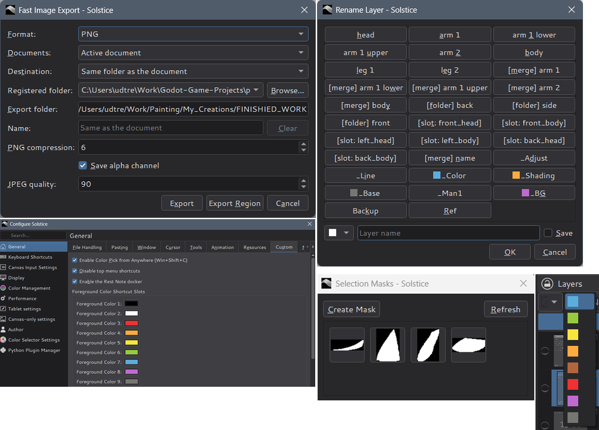
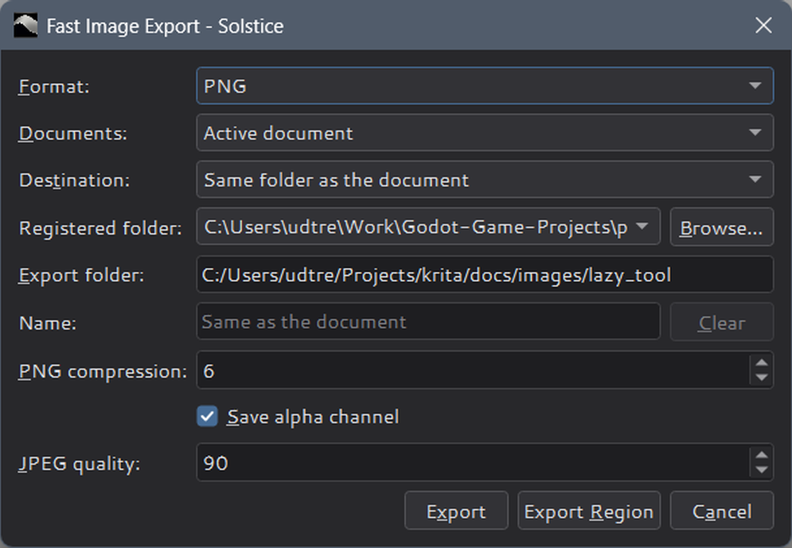
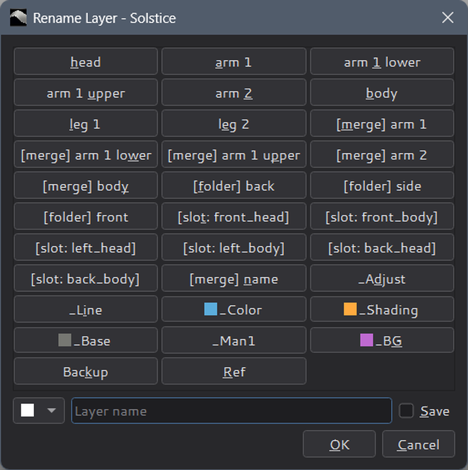
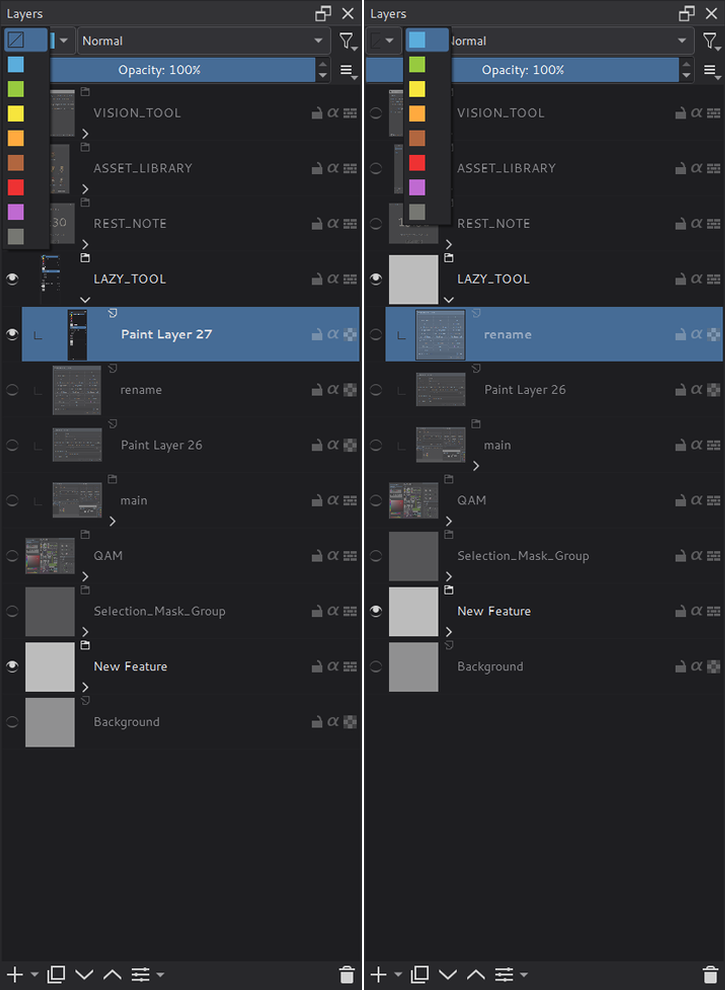
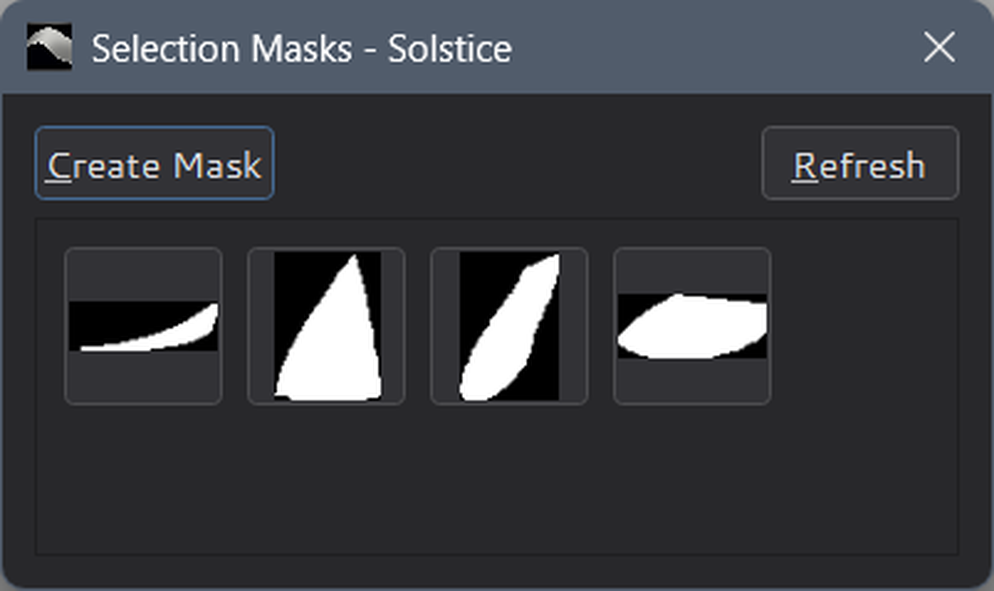
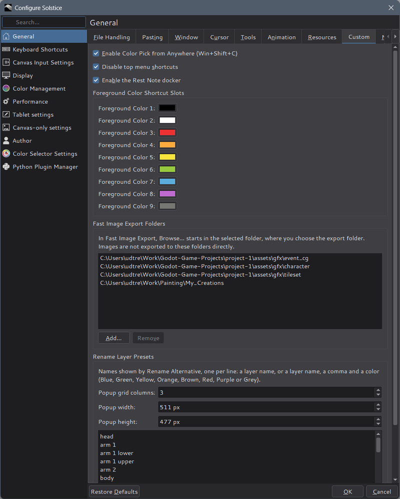

# Lazy Tools

Solstice includes native versions of the core productivity features from the
Lazy Tools Python plugin: fast PNG/JPEG export, a preset-based rename dialog,
layer color labels, saved selections, foreground color shortcuts and a
system-wide color picker. No separate Lazy Tools docker or Python installation
is required.

For the original, see the plugin repository, [Lazy
Tools](https://github.com/udtren/krita-lazy-tools). This guide covers
Solstice's native version and where it differs.

The dialogs open from actions without default shortcuts. Assign them under
**Settings > Configure Solstice > Keyboard Shortcuts**: search for
**Fast Image Export**, **Rename Alternative**, **Create Selection Mask
Alternative**, **Create Selection Mask Popup** or **Set Foreground Color**.

## Fast Image Export

**Fast Image Export** saves PNG or JPEG copies without changing the document's
file name or saved state.

- **Format:** PNG or JPEG.
- **Documents:** the active document or all open documents.
- **Destination:** the document's own folder, the configured **Export
  folder**, or a folder chosen when you press **Export**.
- **PNG compression**, **Save alpha channel** and **JPEG quality** set the
  format options.

Documents must already have a file name; unsaved documents are skipped and
listed. PNG and JPEG options and the export folder are remembered between
uses. The format's own export options dialog can still appear, as for
File > Export.

### Name

**Name** is optional. Leave it empty to name the image after the document
(`painting.kra` becomes `painting.png`), or type a file name without the
extension to export under that name instead; **Clear** empties the field. A
typed `.png`, `.jpg` or `.jpeg` ending is ignored, and names containing
`\ / : * ? " < > |` or ending with a dot or a space are refused. The name is
used only for the active document: it is unavailable while **Documents** is
**All open documents**. It is not remembered after the dialog closes. An
existing file with the same name is replaced, as with the default name.

### Export Region

**Export Region**, next to **Export**, exports only the selected area of the
active document: the visible image inside the selection, cropped to it, with
areas outside the selection made transparent (white in JPEG). It uses the
same format, destination, name and options as **Export**, so without a name
it also uses the document's name. It needs a selection and a saved document,
and it is unavailable while **Documents** is **All open documents**. The
document and its selection are not changed.

### Registered folders

Register folders you use often, such as a root folder with many subfolders,
under **Settings > Configure Solstice > General > Custom > Fast Image Export
Folders** with **Add…** and **Remove**; they are saved when you press **OK**.

In the export dialog, pick one under **Registered folder** and press
**Browse…** beside it. The folder chooser opens in the registered folder, and
the folder you choose there, often one of its subfolders, appears in
**Export folder**. Choosing a folder also switches **Destination** to
**Configured export folder**; press **Export** as usual. Images are never
exported to the registered folder itself unless you choose it.

Without registered folders, or if the selected one no longer exists, the
chooser starts in the current export folder. You can also type a path, or
drag a folder from the file manager onto **Export folder**, which switches
the destination the same way.

## Rename Layer

**Rename Alternative** opens a grid of preset names at the mouse cursor.
Click a preset to rename the active layer; a preset with a color also sets
the layer's color label. To use another name, type it in the field at the
bottom, pick an optional color and press **OK**. Check **Save** to add it to
the presets. The rename can be undone, and child layers are not changed.

Edit the presets under **Settings > Configure Solstice > General > Custom >
Rename Layer Presets** (this replaces the Python plugin's Name List tab).
Write one preset per line, as `layer name` or `layer name, Color`. Supported
color names are Blue, Green, Yellow, Orange, Brown, Red, Purple, and Grey.
The same group sets the popup's grid columns, width and height. Changes are
saved when you press **OK**; the popup still remembers its size when you
resize it.

Presets remain compatible with the Python plugin and are stored in
`lazy_tools/config/name_color_list.txt` inside the Solstice resource folder
(`%APPDATA%\Solstice\resources` by default). The settings page shows the
exact path.

## Layer color labels

Two compact color controls appear before the blending-mode control of the
Layers docker:

- The first assigns a color label only to the explicitly selected layers.
  Selecting a group does not change any of its child layers.
- The second toggles visibility for every layer with the chosen color label.
  Choose the same color again to toggle them back.

The existing layer-list filter button remains available for filtering the
docker by name or color without changing layer visibility.

## Selection masks

- **Create Selection Mask Alternative** saves the current selection as a mask
  in a hidden `Selection_Mask_Group` at the bottom of the layer stack, then
  deselects. Saving can be undone.
- **Create Selection Mask Popup** opens the **Selection Masks** dialog: a
  thumbnail for every saved selection. Click a thumbnail to make it the
  current selection again. **Create Mask** saves the current selection and
  **Refresh** reloads the thumbnails.

The group name is the same as in the Python plugin, so masks saved there
still appear.

## Settings

**Settings > Configure Solstice > General > Custom** holds all Lazy Tools
settings. The page scrolls.

- **Enable Color Pick from Anywhere (Win+Shift+C)** registers the fixed
  Windows system-wide shortcut `Win+Shift+C`. It samples the pixel under the
  cursor, including from another application, and makes it the foreground
  color. Windows only; on by default.
- **Disable top menu shortcuts** removes mnemonic activation from the top
  menu labels from startup, including menus added or rebuilt later. This frees
  combinations such as `Alt+E` for your own shortcuts. Menus remain
  accessible by mouse; shortcuts inside an open menu are unchanged. On by
  default; turn it off to restore menu mnemonics.
- **Foreground Color Shortcut Slots** sets the nine colors used by the **Set
  Foreground Color 1** to **9** actions.
- **Fast Image Export Folders** and **Rename Layer Presets** are described
  above.

**Enable the Rest Note docker** on the same page belongs to
[Rest Note](rest-note.md), not to Lazy Tools.

## Differences from the Python plugin

Existing shortcuts, rename preset files and selection masks remain
compatible. Export options are now stored in Solstice's settings instead of
the plugin's `common.json`.

- **Fast Image Export** is one dialog opened by a shortcut instead of twelve
  buttons in the Lazy Tools docker. It adds the export name, Export Region and
  registered folders.
- **Color labels** apply only to the selected layers, as before; the color
  visibility control does not set opacity (the plugin's **Shift + click**
  menu).
- **Settings** moved from the docker's settings dialog to **General >
  Custom**.

These plugin features are not included:

- the Lazy Tools docker itself, with its Name Filter, Scripts, AI
  Segmentation and Image Export sections (for AI-assisted selection, see
  [Vision ML](vision-ml.md));
- **Add New Layer Alternative**, **Duplicate Layer Alternative** and
  **Deselect Alternative**;
- **Expand All Folders** and **Fold All Folders**.
