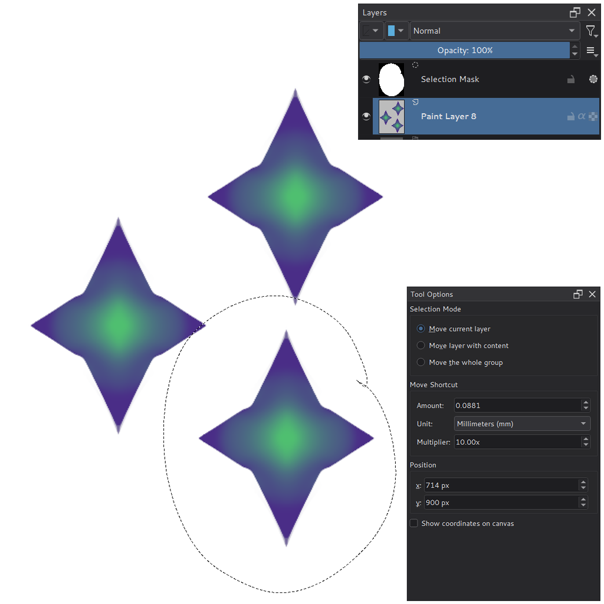

# Move Tool

Solstice's Move Tool works as in Krita (see the
[Krita manual](https://docs.krita.org/en/reference_manual/tools/move.html)),
with one addition: duplicating a selection on the same layer.

## Duplicating a selection

To copy part of a layer and place the copy somewhere else on the same
layer, as Alt-drag does in Photoshop:

1. Select the area on a paint layer with any selection tool.
2. Choose the **Move Tool** and **Ctrl-drag** inside the canvas. The
   selected pixels stay where they are, and a copy follows the cursor.
3. Release the mouse button to place the copy. The selection moves to the
   copy.

Ctrl-drag again to stamp another copy, taken from the last one. Each copy is
one undo step, **Duplicate Selection**. Before you place the next copy, a
plain drag or the arrow keys move the copy you just made; the original
still stays.

- Press **Shift** after the drag has started to keep the copy on a
  horizontal or vertical line, or **Alt** for precise, slower movement.
  Holding them before you press the mouse button starts another Ctrl action
  instead.
- A Ctrl-click without dragging changes nothing.
- The copy is laid over what is under it, so semi-transparent parts, for
  example the edge of a feathered selection, add up where the copy overlaps
  other pixels.
- On a [Brush Stroke Layer](brush-stroke-layer.md), the remembered strokes
  inside the selection are copied with the pixels, so the copies are drawn
  again sharp when you enlarge the layer.
- On an animated layer, duplicating on a frame without a keyframe creates
  one, as moving does.
- Ctrl-drag without a selection, or on a layer that is not a paint layer,
  still moves the layers as before.
- With the **Photoshop compatible** canvas input profile, the same action
  is on **Alt-drag**.

The copy cannot be rotated or scaled while you drag it. For that, use
**Edit > Paste into Active Layer** (`Ctrl+Shift+V`) after copying, which
opens the copy in the Transform Tool.
