# Quick Access Manager

Quick Access Manager gathers brushes, actions, dockers and other Solstice
resources in one place. Its original concept was to bring Clip Studio
Paint's Quick Access palette to Krita. It started as the Python plugin
[Quick Access Manager](https://github.com/udtren/krita-quick-access-manager);
in Solstice it is built in and reimplemented in C++, so no Python
installation is needed.

It consists of four parts:

- the **Quick Access Palette** docker and its popup,
- a **Gesture System** for keyboard-and-mouse shortcuts,
- the **Quick Brush Adjustments** docker,
- the **HueSVC** color selector docker and its popup.

Open the dockers from **Settings > Dockers**. Solstice has no right-click
Popup Palette or On-Canvas Brush Editor; the Quick Access Palette popup, the
HueSVC popup and Quick Brush Adjustments take their place. Right-click with a
brush tool does nothing; other tools keep their right-click menus.

## Contents

- [Quick Access Palette](#quick-access-palette)
  - [Item types](#item-types)
  - [Resources and aliases](#resources-and-aliases)
  - [Brushes](#brushes)
  - [Item properties](#item-properties)
  - [Moving items](#moving-items)
  - [Grid Edit](#grid-edit)
  - [Popup](#popup)
- [Gesture System](#gesture-system)
- [Quick Brush Adjustments](#quick-brush-adjustments)
  - [Temporary keys](#temporary-keys)
  - [Temporary brushes](#temporary-brushes)
  - [Floating Tool Options](#floating-tool-options)
- [HueSVC](#huesvc)
- [Shortcuts](#shortcuts)
- [Settings](#settings)
- [Where settings are stored](#where-settings-are-stored)
- [Differences from the Python plugin](#differences-from-the-python-plugin)

## Quick Access Palette

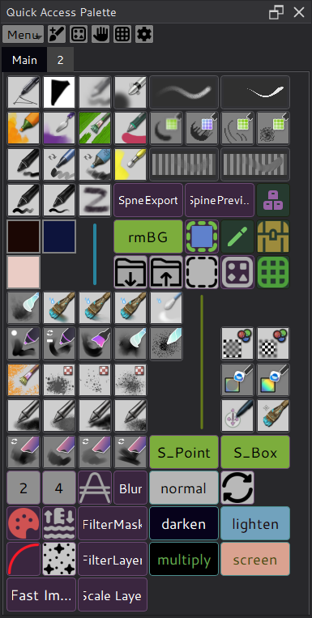

The Quick Access Palette is the main docker. Its header holds the **Menu**
button and buttons for **Add Current Brush**, **Resources**, **Gesture
Settings**, **Edit Grid** and the settings. Items are arranged on a fixed grid
in tabs; the grid's width comes from its column count and cell size, so
resizing the docker does not rearrange items.

### Item types

| Item type | Purpose | Size |
| --- | --- | --- |
| Brush | Switch to a brush preset | Stroke preview: 2x1; icon: 1x1 |
| Action | Run a Solstice action | Text: 2x1 by default, resizable; icon: 1x1 |
| Docker | Show or hide a docker | Text: 2x1 by default, resizable; icon: 1x1 |
| Color | Set the foreground color | 1x1 |
| Brush Size | Set the brush size | 1x1 |
| Brush Blending Mode | Set the brush blending mode | 2x1 |
| Python Script | Run a Python script | Text: 2x1 by default, resizable; icon: 1x1 |
| Label | Show custom text | Resizable width |
| Separator | Horizontal or vertical line | Resizable along its direction |

Python Script items need a Solstice build with Python support and the Python
engine enabled.

### Resources and aliases

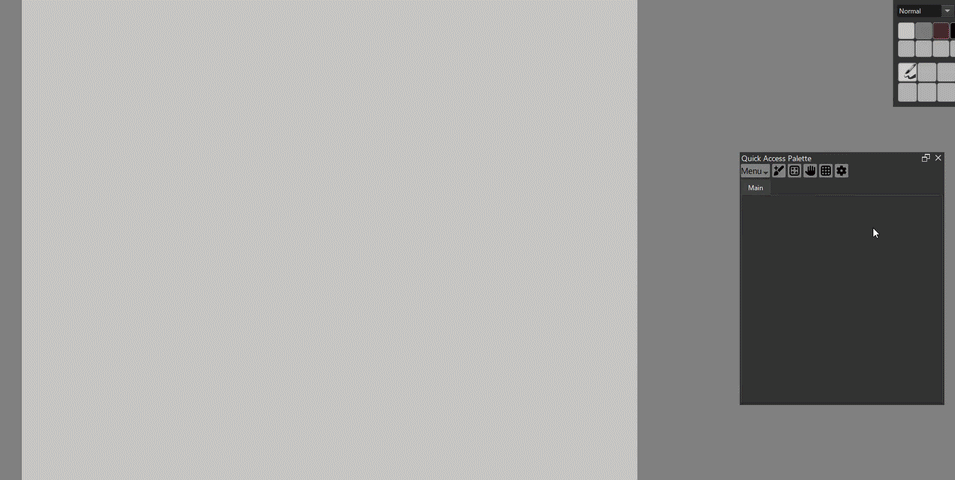

Click **Resources** to open the Resources dialog. Choose a brush, action or
docker and click **Add** to place it on the palette. Items added this way fill
the palette's last empty row from the left and continue on the next row when
the row is full. **Add Current Brush** in the header adds the active brush
preset.

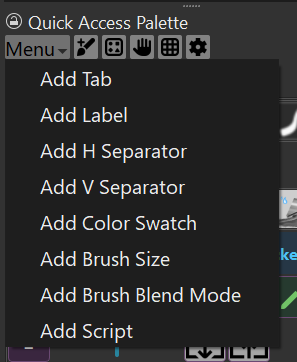

The other item types are added from the **Menu** button: **Add Tab**, **Add
Label**, **Add Horizontal Separator**, **Add Vertical Separator**, **Add Color
Swatch**, **Add Brush Size**, **Add Brush Blending Mode** and **Add Python
Script**. Each item added from the menu starts a new row.

The Resources dialog also manages **aliases**: a custom name, icon and colors
for an action or docker. Aliases are shared: changing one updates every
Action and Docker item, and every gesture, that uses the action or docker.

### Brushes

The **Brushes** tab of the Resources dialog works like the
[Brush Presets](brush-stroke-preview.md) docker: stroke previews with names,
tags, search, the **Engines** and **Bundles** filters and the grouping
dropdown (shared with the docker). Select several presets with Ctrl or Shift
and click **Add Selected Brushes**, or double-click a preset.

A brush added to the palette shows its stroke preview over two cells, without
the name; the name appears in the tooltip. Brushes added before stroke
previews existed keep their icon until their display is changed.

### Item properties

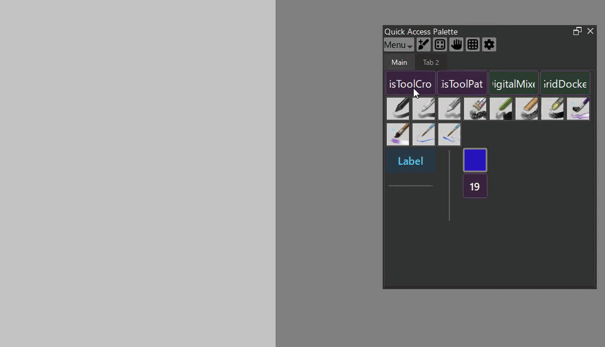

Right-click an item and choose **Properties** to change its text, colors,
font size or icon, depending on the item type. Icons can be any image file on
your computer. Cancelling leaves the item unchanged.

For a brush, **Display** chooses **Stroke Preview** (two cells) or **Icon**
(the preset icon, one cell). Changing it resizes the item and moves the
following items as needed.

For Action and Docker items, the same properties can be edited in the
Resources dialog, which updates the shared alias everywhere it is used.
Giving an Action or Docker an icon makes every item that uses it one cell
wide; the cell it no longer covers is left empty. Removing the icon keeps
the item at one cell; widen it again in Grid Edit. Palettes saved with a wider
icon item are corrected when they load.

### Moving items

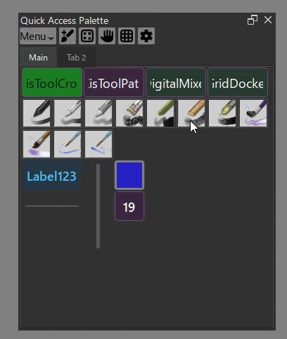

**Ctrl + drag** an item to move it to another cell. A frame shows where it
will land; items in the way are moved aside. A plain click still uses the
item, and any other mouse button cancels the drag. Remove an item from its
right-click menu. Resizing, multi-selection and moving items between tabs are
done in Grid Edit.

### Grid Edit

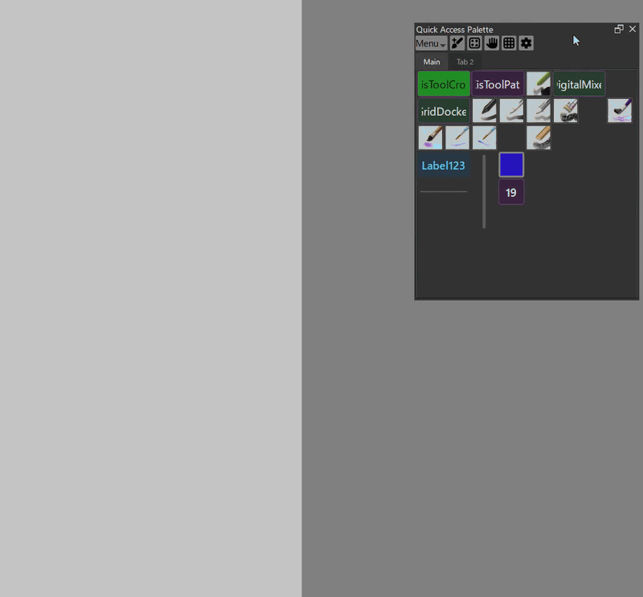

Click **Edit Grid** to open the Grid Edit dialog:

- Ctrl-click items, or drag a selection rectangle, to select several items and
  drag them together.
- Drag a text item's edge or a separator's end to resize it.
- The right-click menu removes items or copies or moves them to another tab.
- **Undo** reverts moves and resizes in the current tab.
- **Save** applies the edited layout; **Cancel** leaves the palette unchanged.

### Popup

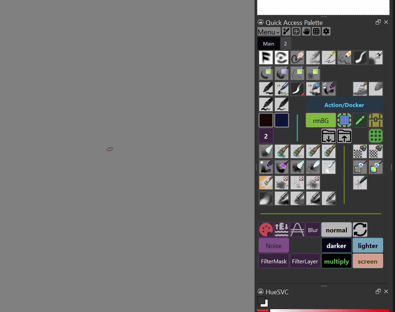

The **Quick Access Palette Popup** shortcut opens the palette at the cursor.
The popup shares the docker's tabs and items but only runs them; edit the
layout in the docker. Press the shortcut again to close it. An unpinned popup
closes after you choose an item; pin it to keep it open. Drag the empty part
of its header to move it.

**Move Quick Access Palette Docker to Cursor** floats the docker and centers
it on the cursor, or docks it again if it is already floating, so you can
reposition it without leaving the canvas. The idea comes from
[DockerUnderCursor](https://github.com/Aqaao/DockerUnderCursor).

## Gesture System

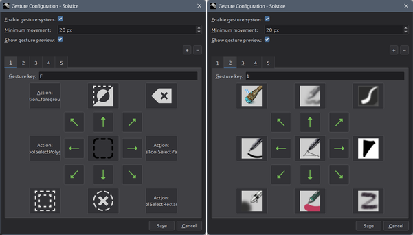

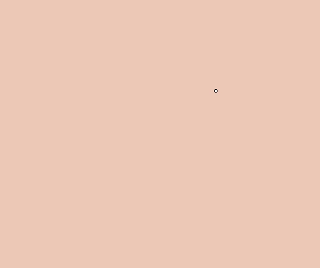

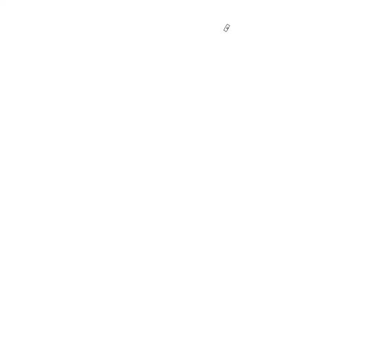

Gestures run an action when you hold a key and move the mouse:

- **Nine directions:** a different action for each of eight directions, plus
  one for pressing and releasing the key without moving.
- **Pages:** each gesture page has its own key and nine actions.
- **Actions:** a brush preset, a Solstice action, or showing or hiding a
  docker.
- **Sensitivity:** the minimum movement that counts as a direction.

### Setting up gestures

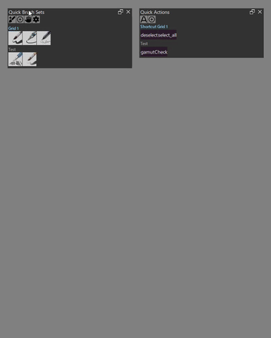

1. Click **Gesture Settings** in the Quick Access Palette header.
2. Click **+** to add a gesture page, or select an existing one. **−** removes
   the current page.
3. Type the page's key in **Gesture key**, for example `F`, `1` or `F5`. If
   the key already has a Solstice shortcut, remove that shortcut first:
   Solstice's shortcuts take priority.
4. Click an arrow or the square next to it to choose that direction's action.
   The center square is the action for pressing and releasing the key without
   moving. Choose **Brush**, **Action** or **Docker** as the type and pick the
   resource, or choose **Empty** to clear the direction.
5. At the top of the dialog:
   - **Enable gesture system** turns gestures on or off.
   - **Minimum movement** sets the distance, 1 to 200 pixels, the mouse must
     move before a direction is chosen.
   - **Show gesture preview** turns the preview overlay on or off.
6. Click **Save**. The changes apply at once.

### Using gestures

1. Hold the gesture key.
2. Move the mouse in one of the eight directions.
3. Release the key to run that direction's action. Release without moving to
   run the center action.

Gestures are ignored while you type in a text field or a dialog is open.
The **Toggle Gesture Recognition** shortcut, or the gesture button of Quick
Brush Adjustments, pauses gestures without turning the system off.

### Preview overlay

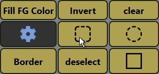

While you hold a gesture key, an overlay around the cursor shows the action
for each direction. Turn it off with **Show gesture preview**.

## Quick Brush Adjustments

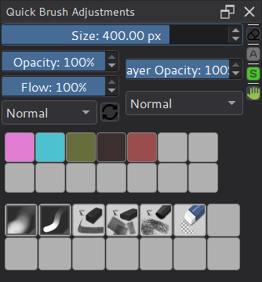

Quick Brush Adjustments keeps common painting settings in one docker:

- **Brush:** size, opacity and flow bars, the brush blending mode, and a
  button that reloads the current brush preset.
- **Layer:** the active layer's opacity and blending mode.
- **Color history** and **brush history:** recently used colors and brush
  presets. Color history starts empty in each session.

The bars are the same controls as Tool Options: each shows its name and
value; double-click to type a value, Shift + drag for fine steps. The size
bar covers the full brush size range and moves in finer steps at small sizes,
like the brush tip's Diameter. Each bar can be hidden from the settings.

The column on the right shows and toggles states:

- **Show Tool Options** (when floating Tool Options is enabled),
- **eraser mode**,
- **preserve alpha**,
- whether the **selection outline** is shown,
- the **gesture system**: click to pause or resume gestures.

**Move Quick Adjust Docker to Cursor** floats the docker at the cursor, or
docks it again.

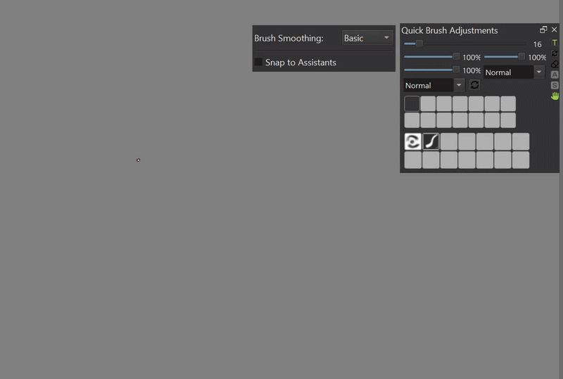

### Temporary keys

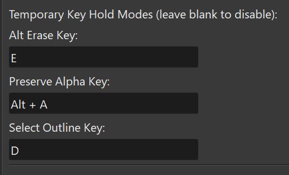

Hold a key to switch a state on; release it to restore the previous state. The
keys are empty (off) by default. Set them on the **Quick Brush Adjustments**
tab of the settings:

- **Temporary eraser key:** eraser mode.
- **Temporary preserve-alpha key:** preserve alpha.
- **Temporary freehand-selection key:** the Freehand Selection tool; release to
  return to the brush tool.

### Temporary brushes

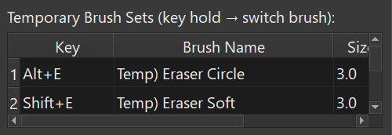

Hold a key or key combination to switch to another brush preset; release it to
return to the previous brush and size. On the **Temporary Brushes** tab of the
settings:

1. Click **Add Row**.
2. Enter the **Hold Key**, for example `Alt+1`, `Ctrl+F1` or `F5`.
3. Enter the name of the **Brush** preset.
4. Set the **Size Scale**: a multiplier for your current brush size (`0` keeps
   the brush's own size, `0.5` halves it, `2.0` doubles it).
5. Click **Save**.

Add as many rows as you need; **Remove Row** deletes one.

Temporary keys and brushes apply to the active window. Releasing the key,
switching to another window or leaving Solstice restores the state in the
original window. Keys typed into text fields do not trigger them.

### Floating Tool Options

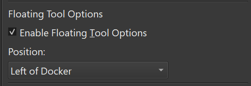

With **Enable floating Tool Options**, Quick Brush Adjustments shows the Tool
Options docker's contents in a panel beside it. **Tool Options position**
places it left of the docker, right of the docker, or below it. The panel
follows the docker when it moves and returns its contents to Tool Options when
it closes.

## HueSVC

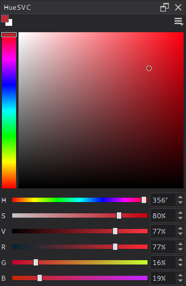

HueSVC is a compact color selector: a hue bar, a saturation/value square and
bars for H, S, V, R, G and B.

- Small overlapping foreground and background swatches sit at the top left;
  click either to swap the colors.
- The button at the top right chooses the selector shape: a vertical hue bar
  beside the square (the default) or the square inside a hue ring. The choice
  applies to the docker and the popup.
- Drag a channel bar, use its arrow buttons, or type a value.
- The hue bar and square use all the docker's spare height.
- HueSVC follows Solstice's foreground and background colors.
- HueSVC always picks colors in RGB. It uses the selected layer's color space
  when that is RGB. For a filter or fill layer, a mask, or a grayscale layer,
  it uses the image's color space if that is RGB, and 8-bit sRGB otherwise.
  It updates when you select another layer or convert the image.

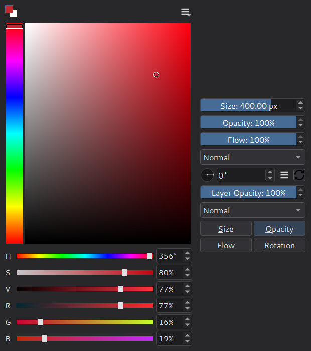

The **HueSVC Popup** shortcut opens HueSVC at the cursor. The popup closes
when the pointer leaves it. Its right-hand panel holds the brush size,
opacity, flow and blending mode, the brush rotation dial (with its flip
options in a menu button), the preset reload button, the layer opacity and
blending mode, and pressure-sensitivity toggles. Opening a blending-mode list
keeps the popup open while the list is in use.

## Shortcuts

Assign these in **Settings > Configure Solstice > Keyboard Shortcuts**, under
Quick Access:

| Action | Effect |
| --- | --- |
| Quick Access Palette Popup | Open or close the palette at the cursor |
| HueSVC Popup | Open HueSVC at the cursor |
| Toggle Gesture Recognition | Pause or resume gestures |
| Move Quick Access Palette Docker to Cursor | Float the palette at the cursor, or dock it again |
| Move Quick Adjust Docker to Cursor | Float Quick Brush Adjustments at the cursor, or dock it again |

## Settings

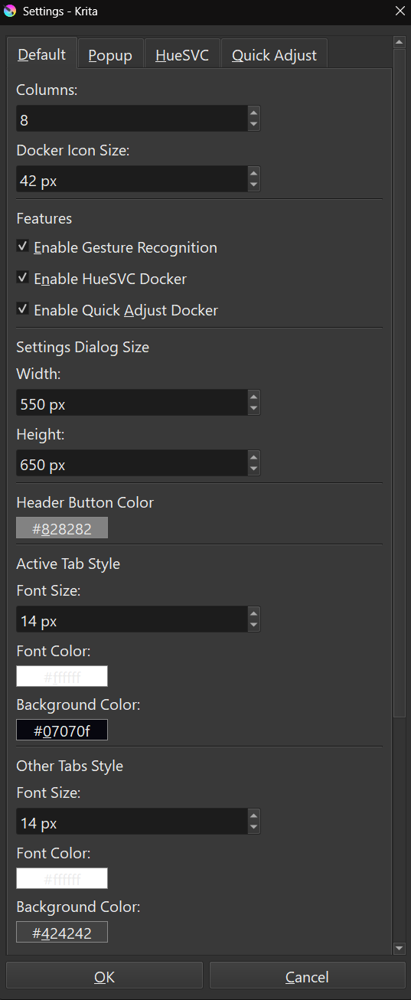

The settings dialog has four tabs:

- **General:** grid columns and icon size, which parts are enabled, header
  button and tab colors and font sizes, and the settings dialog's size. If
  gestures, HueSVC or Quick Brush Adjustments affect performance, turn them
  off here; the HueSVC and Quick Brush Adjustments switches take effect after
  restarting Solstice.
- **Popup and HueSVC:** the palette popup's icon size and whether it closes
  after choosing an item, and the HueSVC popup's size, RGB display and
  controls panel.
- **Quick Brush Adjustments:** visible bars, history counts and icon sizes,
  the temporary keys, floating Tool Options, and the blending modes offered
  in the lists.
- **Temporary Brushes:** the temporary brush rows.

## Where settings are stored

- The palette profile (tabs, items and aliases) is `quickaccess\default.kqap`
  in the resource folder: `%APPDATA%\Solstice\resources\quickaccess\` by
  default.
- Gesture, HueSVC, Quick Brush Adjustments and appearance settings are stored
  in Solstice's `kritarc`.

See [Settings folder](settings-folder.md) for the folder locations.

Profiles, aliases, custom labels, colors and icons from the Python plugin
still load: when the resource folder contains the plugin's
`quick_access_manager\remaster\` configuration and no Solstice profile exists
yet, Solstice imports it on first start.

## Differences from the Python plugin

- Built in and written in C++; no Python installation is needed, except for
  Python Script items.
- Brushes show stroke previews, and the Resources dialog's Brushes tab has the
  Brush Presets docker's filters and grouping.
- The adjustment bars are Tool Options' controls.
- HueSVC has a selector shape choice and smaller color swatches.
- Brush rotation is only in the HueSVC popup, not the Quick Brush Adjustments
  docker or a floating widget.
- Gesture keys, temporary keys and temporary brushes apply as soon as the
  settings are saved; no restart is needed.
- Temporary keys and brushes work per window when several windows are open.

Native implementation: [`../plugins/dockers/quickaccess`](../plugins/dockers/quickaccess/)
