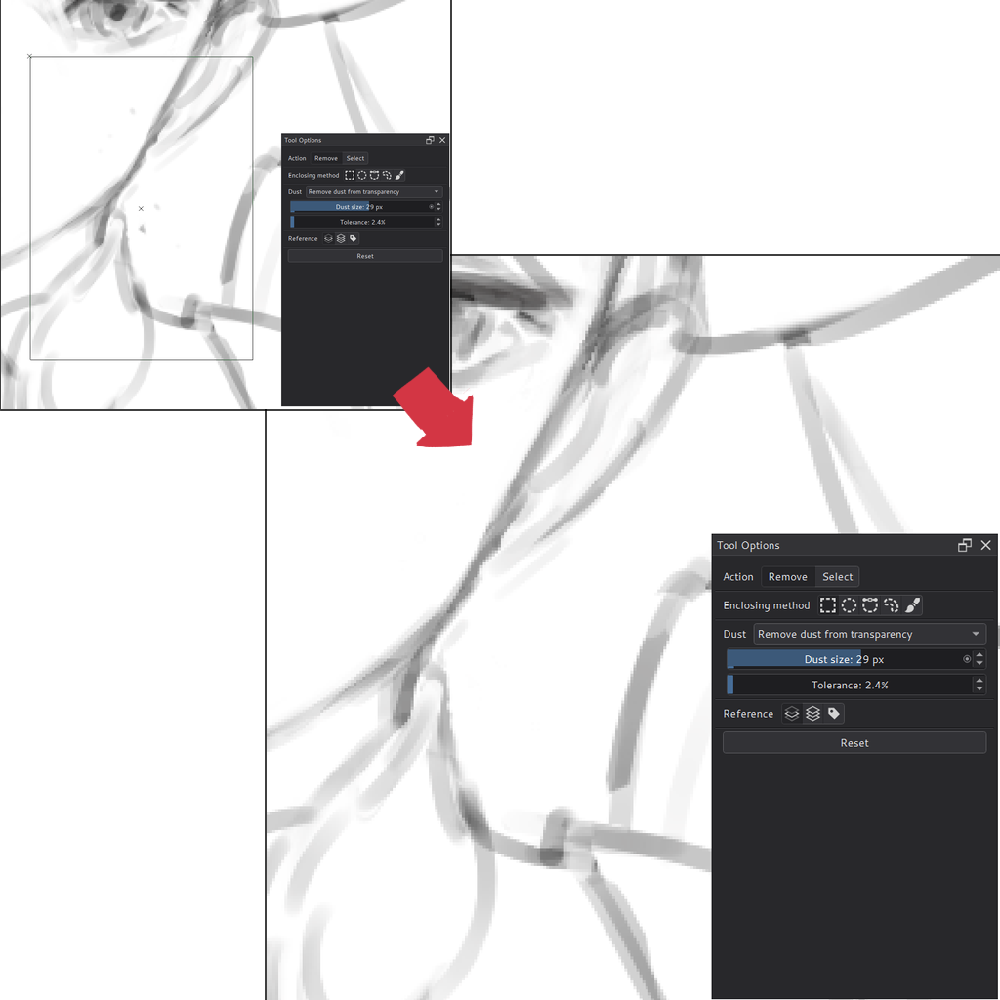

# Remove Dust

Remove Dust cleans up small specks left on line art and scanned drawings,
and fills small holes left in flat color. It was added in Solstice 0.5.0
and comes in two forms:

- the **Remove Dust Tool**, in the fill section of the toolbox, which works on
  an area you enclose on the canvas;
- the **Remove Dust** filter, **Filter > Enhance > Remove Dust...**, which works on
  the whole layer, a selection, a filter mask or a filter layer.

Both find the same dust. This is Solstice's own implementation, inspired by
the Remove Dust tools of CLIP STUDIO PAINT, and does not reproduce their
results pixel for pixel.

## What counts as dust

A spot is dust when its width and height are both at most **Dust size**
pixels and it is completely surrounded by the background. Spots that touch
each other, including corner to corner, count as one spot, so a thin
diagonal line is not dust.

| Mode | Dust is | Replaced with |
| --- | --- | --- |
| Dust on transparency | opaque or semi-transparent specks surrounded by transparency | transparency |
| Dust on white background | non-white specks surrounded by white (or transparency) | opaque white |
| Transparent gaps | transparent or semi-transparent holes inside painted areas | the main surrounding color, or a color you choose |

**Tolerance** (0–100%, 2% by default) changes what counts as background:

- Dust on transparency: pixels at or below this opacity count as
  transparent. The default ignores nearly invisible pixels, such as eraser
  leftovers or the edge of a soft brush, which would otherwise join a speck
  to a nearby line so that it is not removed. If a visible speck is still
  not removed, raise Tolerance to about 5%. At 0, any pixel with some
  opacity belongs to a speck, so even its faintest edge is removed with it.
- Dust on white background: colors this close to white count as white.
  Raise it for scanned or off-white paper.
- Transparent gaps: pixels at least this much below full opacity are gaps.
  At 0, every pixel that is not fully opaque is a gap.

For a gap on the border between two colors, the main surrounding color is
the color that surrounds most of the gap, not a mix of the two.

## Remove Dust Tool

1. Choose the tool and an **Action**: **Remove** changes the active layer;
   **Select** turns the dust into a selection so you can check it first.
2. Choose an **Enclosing method**: rectangle, ellipse, Bezier curve, lasso
   or brush. These behave as in the Enclose and Fill Tool.
3. Choose the mode, **Dust size** and **Tolerance** in the **Dust** section.
   In Remove, **Fill transparent gaps** fills with the **Surrounding color**
   or the **Foreground color**.
4. Enclose an area on the canvas. A short message reports how many spots
   were found.

With the rectangle, ellipse, curve and lasso, only spots entirely inside
the enclosed area are changed. With the brush, every spot the stroke
touches is changed, so you can paint over gaps without covering each one
completely. This replaces CLIP STUDIO PAINT's separate Fill leftover tool:
use the brush with **Fill transparent gaps**.

In **Select**, the **Selection mode** buttons replace, intersect, add to,
subtract from or toggle the current selection, as in the selection tools.
In **Remove**, an active selection limits the change to selected pixels, as
when painting.

**Reference** chooses where dust is looked for: the active layer, all
layers merged, or the layers with chosen color labels. Remove always changes
only the active layer. For example, with **All layers**, gaps found in the
merged image are filled in the active color layer.

Every use of the tool is one undo step. The options are remembered between
sessions. **Reset** restores the defaults.

## Remove Dust filter

The filter has the same modes, **Dust size** and **Tolerance**, and a fourth
mode, **Fill transparent gaps with a color**, with its own color button.
It supports previews, filter masks and filter layers.

The filter looks at the whole layer. With a selection, spots crossing the
selection edge may be changed only partly, so use the tool to clean an
exact area.

## Limitations

- Dust size is limited to 1000 pixels (the slider goes up to 50 and
  accepts larger typed values). Large sizes over large areas take longer.
- Remove writes pixels directly; it ignores **Lock alpha** on the layer
  and the brush's blending mode.
- The tool works on paint layers and other layers that can be painted on.
  **Select** also works on group layers, through their merged image.
- Interactive confirmation is pending.

Technical record: [Remove Dust](agent/remove-dust.md).
