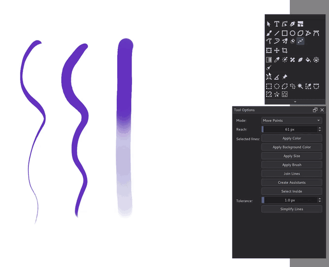
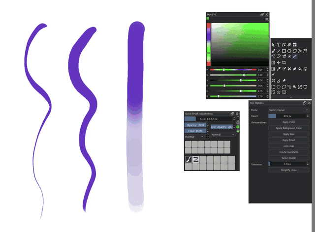
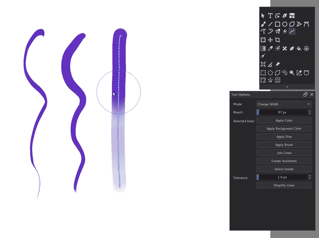
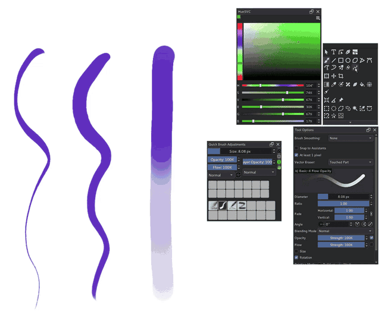
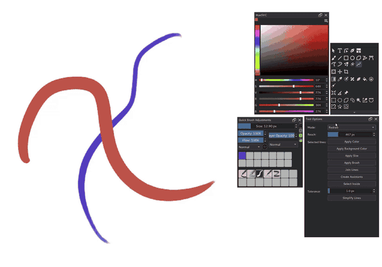
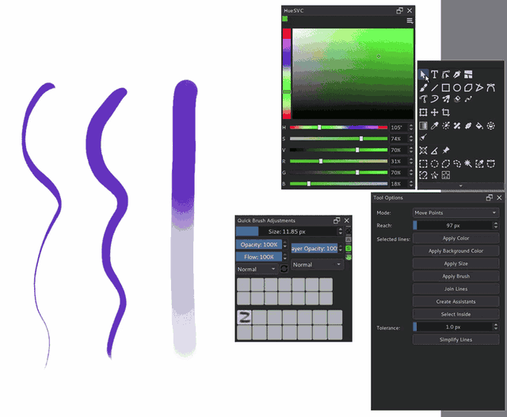
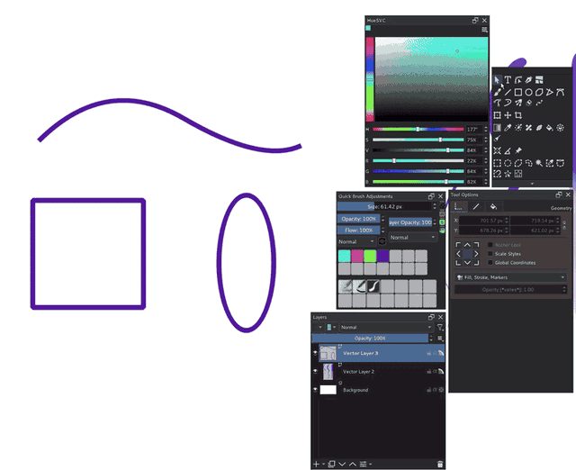

# Vector Brush Strokes

Brush strokes on vector layers: the brush tools draw on a vector layer
with any brush preset. Each stroke becomes its own object on the layer: it
looks like the stroke you painted,
and it is drawn again with the same brush whenever it is resized, so line
art stays sharp. This is the editable counterpart of the
[Brush Stroke Layer](brush-stroke-layer.md), which keeps its strokes as
pixels.

## Drawing

- Select a vector layer and paint with the **Freehand Brush**, the
  **Dynamic Brush** or the **Multibrush**. The stroke appears while you
  draw, as on a paint layer, and stays as an object when you lift the pen.
- Each stroke lies above the earlier ones. Undo removes it, redo returns it.
- The brush, colors, opacity, pressure and the canvas mirror are kept with
  the stroke.
- A selection does not clip a stroke on a vector layer.

## Erasing

Switch the brush tool to eraser mode (the **E** key or the eraser button)
and drag over the lines. The eraser does not paint: it cuts the lines.

- **Touched Part** removes the part of a line under the eraser. What is
  left on each side becomes a line of its own, with a rounded end drawn by
  the brush, and can be selected, moved and erased separately.
- **Whole Line** removes every line the eraser touches.
- **Up to Intersection** removes a touched line as far as the next line
  that crosses it on each side, or to its end where nothing crosses it.
  Draw lines past each other (a window frame, hatching over an outline) and
  touch the overshoot to trim it. A line that ends at another line without
  passing it counts as crossing it. A line also stops at its own loops and
  at the other copies of a Multibrush stroke.

Choose between them with **Vector Eraser** in the Tool Options of the
Freehand Brush; the choice applies to all brush tools. The eraser is as
large as the brush outline shows, whatever the pen pressure. One drag is
one undo step.

With the Multibrush Tool the eraser works at every copy of the brush, as
the tool is set up when the drag starts (symmetry, mirror, snowflake,
translate, copy translate), so a figure drawn with the Multibrush is
erased on all its sides at once. With the Freehand Brush it erases under
the pen only: each copy of a Multibrush stroke is a line of its own.

The part of a line before a cut looks exactly as it did. The part after it
is drawn again from the cut, so with soft, textured or scattering brushes
its dabs can land slightly differently; ink pens show no difference.

## Editing a line's path

The **Edit Brush Strokes Tool** (in the toolbox next to the Through-Layer
Eraser) changes the lines themselves. Move the cursor over a line on the
active vector layer: its path appears, with its control points, the points
the pen passed through. Choose what a drag does with **Mode** in Tool
Options:

- **Move Points**: drag part of the line. The dragged point follows the
  cursor and its neighbours follow less and less, up to **Reach** along
  the line (in image pixels; a dashed circle shows it). A Reach of 0 moves
  a single control point.
- **Change Width**: drag to the right for a wider line, to the left for a
  thinner one, again around the dragged point up to Reach. It changes the
  pen pressure recorded with the line, so it works for brushes whose size
  follows pressure.
- **Cut**: click a line to cut it in two there. Nothing is removed; the
  two parts can then be moved or erased separately.
- **Add Point**: click a line to add a control point there. The line does
  not change until the point moves: keep the button down and drag, and
  the new point alone follows the cursor (Reach is not used). Clicking an
  existing control point and dragging moves that point alone.
- **Delete Point**: click a line near a control point to remove it; the
  marker shows which one. The two parts of the line that met there become
  one curve that follows them as closely as one curve can. Deleting the
  first or last point shortens the line by its first or last part. A line
  keeps at least two control points.
- **Switch Corner**: click a line near a control point to switch it
  between a corner and a curve; the marker shows which point. In this mode
  corners are drawn as squares and curve points as circles. A corner
  becomes a curve that passes through the point without a turn, in the
  direction from the control point before it to the one after it. A curve
  point becomes a corner: the line runs into the point and out of it
  without rounding. The first and last point of a line cannot be switched.
  Switching a point twice gives a standard curve, not always the shape it
  had before; undo gives that back.
- **Change Density**: drag left on a line to make it lighter around that
  place, and right to bring it back. Reach sets how far along the line the
  change runs. The ink the brush laid down becomes more transparent there,
  so this works with every brush; a line cannot become denser than it was
  drawn.
- **Add Width**: drag right on a line to make it wider by a fixed amount
  around that place, and left to make it thinner: one pixel of width for
  every four pixels of the drag. Unlike Change Width, thick and thin
  places get the same amount, and the line can become wider than the
  brush it was drawn with. With a long Reach the whole line changes.
- **Free Transform**: click lines to select them; a frame with handles
  appears around them. Drag a corner to pull that corner anywhere (the
  lines follow in perspective), drag a handle on a side to move that
  side, and drag inside the frame to move the lines. Only the selected
  lines change; the other lines of the layer stay. The frame keeps its
  shape for the next drag as long as the same lines stay selected. While
  you drag, thin blue lines show where the lines will go; they are drawn
  again when you release. The brush size follows the size the lines get.
- **Redraw**: start on a line and draw the path a part of it should
  take. If you end on the same line, the part between the two places is
  replaced by what you drew. If you end away from the line, the rest of
  the line follows your path, towards the end you drew to. The line keeps
  its brush, color and width: the pen pressure of the old part is spread
  along the new one. You can draw in either direction.
- **Redraw Width**: trace part of a line, and that part gets the width
  the current brush would paint there: its size, and with a pen the
  pressure you trace with. The line stays where it is and keeps its own
  brush and color; only its width changes, and the rest of the line keeps
  the width it had. Choose the brush size before you trace. While you
  trace, a band as wide as the brush shows where you are.

The line is drawn again with its brush while you drag. Each drag or click
is one undo step.

Add Point, Delete Point and Switch Corner are most useful on a simplified
line (see "Fewer control points" below): a freshly drawn line has a
control point every few pixels, so changing a single one changes very
little. On such a line every control point counts as a corner.

### Color, size and brush of lines

Click a line without dragging to select it; its path turns orange. Click
more lines to add them, click a selected line again to take it out, and
click beside the lines to select nothing. The selection is the vector
layer's own: lines selected with the Select Shapes Tool are selected here
too.

The buttons under **Selected lines** in Tool Options then draw the selected
lines again:

- **Apply Color**: with the current foreground color.
- **Apply Background Color**: with the current background color. It shows
  only with brushes that use the background color: those that mix the two
  colors (the Mix option) or paint a gradient between them. When it
  shows in none of the selected lines, a message says so; the background
  color is stored all the same. A brush that mixes the colors by pen
  pressure shows none of it in a line drawn at full pressure (with a
  mouse).
- **Apply Size**: with the current brush size.
- **Apply Brush**: with the current brush preset, at the width each line
  has. The line's path and pen pressure stay; only the brush changes.

Each button is one undo step for all selected lines. Choose the color, size
or preset as you would for painting; the buttons take whatever is current.

### Joining lines

Select two or more lines and press **Join Lines** in Tool Options. The
lines become one: the two nearest ends are connected by a straight piece,
and with more than two lines the next nearest ends follow until one line
is left. A line is turned around when that is needed to connect it.

- The joined line takes the brush, size and color of the line you selected
  first.
- The connection has the pen pressure of the two ends it connects. Ends
  that were drawn with a light, tapering pressure give a thin connection;
  widen it with Change Width, or move the ends together first.
- It is one undo step, and the joined line stays selected.
- Lines drawn with mirrored copies (Multibrush or the mirror tools draw
  several lines as one stroke) cannot be joined.

### Assistants along lines

Select one or more lines and press **Create Assistants** in Tool Options.
Painting assistants appear along the lines: a Spline assistant for every
curved piece and a Ruler assistant for every straight one. The lines
themselves stay as they are.

- To draw along them, pick the Freehand Brush on any layer and turn on
  **Snap to Assistants** in its Tool Options. Turn off **Snap to Single
  Line** there, or the brush stays on the piece it started on.
- The path is simplified first with the **Tolerance** below the buttons:
  a larger tolerance gives fewer assistants.
- It is one undo step. The assistants are ordinary ones: move, hide or
  delete them with the Assistant Tool, and they are saved with the
  document.

The button also works for vector shapes: lines, rectangles, ellipses,
polygons and curves made with the shape tools on a vector layer. Select
them with the Select Shapes Tool, switch to the Edit Brush Strokes Tool
and press **Create Assistants**.

- A whole ellipse or circle becomes one Ellipse assistant, also when it
  is rotated or skewed.
- Any other shape becomes a Ruler assistant for every straight side and
  a Spline assistant for every curved piece of its outline (a rounded
  rectangle: four of each; a pie or an arc: its curves and sides).
- The Tolerance does not apply: the shape's own points are used. Text is
  left out. The shapes stay as they are; hide the vector layer if only
  the assistants are wanted.

### A selection from lines

Select one or more lines and press **Select Inside** in Tool Options. The
area each line encloses becomes the selection, replacing the one there
was.

- A line that is not closed is closed by a straight piece from its end to
  its start, so a loop with a small gap works.
- Where a line crosses itself, all its loops are selected. Several lines
  give the areas of all of them together.
- An outline drawn as several lines is not one area: join them with
  **Join Lines** first.
- A line that encloses nothing (a straight line) gives a message and no
  selection. It is one undo step.

### Fewer control points

A line has one control point for every pen sample. **Simplify Lines** in
Tool Options draws the selected lines again through fewer points, which
makes them easier to reshape with Move Points:

1. Select the lines by clicking them.
2. Set **Tolerance**: how far the simplified line may leave the drawn one,
   in image pixels. 1 px is hard to see; larger values remove more points
   and smooth small wobbles.
3. Press **Simplify Lines**. A message shows how many control points are
   left.

Sharp corners stay sharp at small tolerances, and the line keeps its
changes of width: the pen pressure is part of what the tolerance measures.
Pressing the button again at the same tolerance removes little or nothing.
It is one undo step for all selected lines.

## Editing strokes as objects

Use the **Select Shapes Tool**, as for other vector objects:

- click a stroke on its line to select it, or drag a rectangle around
  several;
- move, resize or rotate it with the handles; delete it with **Delete**;
- copy and paste it, in the same document or another;
- change its stacking order with the arrange actions.

Moving a stroke keeps its picture. Resizing or rotating draws it again along
the new path with the brush scaled to match, when the change is applied.
**Image > Scale Image**, **Layer > Scale Layer** and the **Transform Tool**
on the layer do the same for all its strokes.

While you drag in the Transform Tool the strokes show their existing
pictures scaled, which is fast and a little soft. They are drawn again with
their brushes once, when you apply the transform (or cancel it).

## Saving

A `.kra` file keeps each stroke with its brush settings, colors and the
brush tips, textures, patterns and gradients it uses, so the file redraws
its strokes on a computer without those brushes. Original Krita opens the
strokes as pictures on the vector layer; saving the file there drops what is
needed to draw them again.

## Comparison with Clip Studio Paint

This table lists the vector layer functions described on the official Clip
Studio Paint page
[Mastering vector layers](https://tips.clip-studio.com/en-us/articles/600)
("Layer types and how to use them #3", written for Ver. 1.10.0, as the page
read on 2026-11-18) and what Solstice has for each. Clip Studio Paint may
have functions the page does not mention; they are not listed.

"Yes" means the function exists and is covered by automated tests or
in-application test runs with a mouse or synthetic tablet input; none of
it has been checked with a real pen by the developers' tests.

| Clip Studio Paint (page section) | Solstice | How, and what differs |
| --- | --- | --- |
| Vector layer for drawing with pens and brushes [2] | Yes | A vector layer, then any brush preset with the Freehand Brush, Dynamic Brush or Multibrush |
| Pen pressure recorded with the line [1] | Yes | Tilt, rotation and speed are recorded too |
| Lines redrawn without jaggies when enlarged [1] | Partly | Redrawn with the brush when a stroke, the layer or the image is resized or rotated. Zooming the view shows the document's pixels |
| Path and control points shown on a line [1] | Yes | Edit Brush Strokes Tool: hover over a line. A fresh line has a point for every pen sample until it is simplified |
| Export as SVG line data [1] | Partly | A stroke is written to SVG as a picture, not as a path. The `.kra` file keeps the strokes editable |
| Erase freely, like on a raster layer [3] | Yes | Eraser mode of the brush on a vector layer, **Touched Part**: the line is cut where the eraser passed |
| Erase up to intersection [3] | Yes | **Up to Intersection**. Sees brush strokes on the same layer only. **Whole Line** is available as well |
| Correct line width by painting over an area: scale up, scale down [4] | Partly | **Change Width** mode: drag right or left on a line; the area is set by **Reach** along the line, not painted |
| Object tool: scale and rotate lines with a bounding box [5] | Yes | Select Shapes Tool |
| Object tool: drag control points [5] | Yes | In the Edit Brush Strokes Tool (**Move Points**), not in the Select Shapes Tool |
| Select one line by click, several by dragging [5] | Yes | Select Shapes Tool (click, or drag a rectangle); the Edit Brush Strokes Tool selects by click only |
| Free Transform of selected lines [5] | Yes | **Free Transform** mode of the Edit Brush Strokes Tool: corners, sides and inside of a frame around the selected lines. The Transform Tool itself transforms all strokes of the layer together |
| Change main color of selected lines [5] | Yes | **Apply Color** |
| Change sub color [5] | Yes | **Apply Background Color**: the background color is the sub color. It shows with brushes that use it |
| Change brush size of selected lines [5] | Yes | **Apply Size** |
| Change brush shape of selected lines [5] | Yes | **Apply Brush**: the whole brush preset, at the line's width |
| Control point: move [6A] | Yes | **Move Points**; Reach 0 moves a single point |
| Control point: add [6A] | Yes | **Add Point**; drag to move the new point at once |
| Control point: delete [6A] | Yes | **Delete Point** |
| Control point: switch corners between curve and straight [6A] | Yes | **Switch Corner**. A curve point gets a standard curve through it; there are no handles to shape it further |
| Control point: correct line width by dragging left or right [6A] | Yes | **Change Width**. Works for brushes whose size follows pen pressure, up to the brush size |
| Control point: correct density (opacity) [6A] | Yes | **Change Density**: drag left or right on a line. The finished ink becomes more transparent around the place, with any brush; never denser than drawn |
| Control point: cut line [6A] | Yes | **Cut**, anywhere on the line |
| Pinch vector line: fix end, pinch level, effect range [6B] | Partly | **Move Points** with **Reach** as the effect range. No Fix end and no pinch level |
| Simplify vector line [6C] | Partly | **Simplify Lines** with a **Tolerance** for the selected lines, whole lines only, corners kept. No Round corners option, no Delete shorter line, not applied by brushing over lines |
| Connect vector line [6D] | Partly | **Join Lines** for the selected lines: nearest ends connected by a straight piece. No simplifying while connecting, no gap size, not applied by brushing over the ends |
| Correct line width: thicken or thin by a fixed amount [6E] | Yes | **Add Width** mode: drag right or left on a line; the area is set by **Reach** along the line, not painted. A brush whose size does not follow pen pressure changes for its whole stroke |
| Correct line width: scale up or down [6E] | Partly | **Change Width** around a dragged point; **Apply Size** for whole lines |
| Redraw vector line by tracing over it [6F] | Yes | **Redraw** mode: draw from a place on a line; the part up to where the drawing meets the line again, or the rest of the line, takes the drawn path |
| Redraw vector line width by tracing over it [6G] | Yes | **Redraw Width** mode: the traced part takes the width of the current brush, following the pen pressure of the trace |
| Ruler from vector, Selection from ruler [7] | Partly | **Create Assistants** for the selected lines and vector shapes: Spline, Ruler and Ellipse assistants along their paths, which brushes snap to; **Select Inside** selects the area a line encloses. One assistant per piece of a line, not one ruler per line; the selection comes from the lines, not from the assistants |

## Current limitations

- The Edit Shapes Tool does not work on strokes; use the Edit Brush Strokes
  Tool. A control point has no handles to adjust the curve's direction:
  move, add, delete or switch points instead.
- Simplify Lines keeps only corners that turn by more than 60 degrees. A
  flatter corner made with Switch Corner may be rounded by it, within the
  tolerance.
- Change Density makes the finished ink more transparent within one brush
  size of the line's path. Dabs that a scattering brush puts further away
  stay as drawn, and where a line crosses itself the denser part shows. It
  only makes a line lighter than it was drawn. Simplify Lines does not
  look at the density: between the points that remain it changes evenly.
- Join Lines connects ends with a straight piece and does not smooth the
  joint. With a soft, textured or scattering brush the second line can
  look slightly different after joining, since its dabs fall in other
  places.
- Apply Color changes the foreground color only, and Apply Background
  Color the background color only: a brush that paints with a stored
  gradient or a pattern keeps those. After undo the
  lines are no longer selected.
- A line has one control point for every pen sample, many more than Clip
  Studio Paint shows, until you simplify it. Use Reach to move a stretch
  of them together.
- Simplify Lines keeps the pen pressure within the tolerance but not the
  pen's tilt, rotation and speed between the points that remain: they
  change evenly from one point to the next. With a soft, textured or
  scattering brush the simplified line can look slightly different, since
  its dabs fall in other places.
- Editing a line redraws it from the edited place on, so with soft,
  textured or scattering brushes the rest of the line can change slightly,
  as after an eraser cut.
- Change Width has no effect on brushes whose size does not follow pen
  pressure, and cannot make a line wider than the brush size.
- Add Width changes a line in one place only if the brush's size follows
  pen pressure. Otherwise the line has one width, and the whole stroke
  (with its Multibrush or mirror copies) gets wider or thinner. Where a
  line has to become wider than its brush, the brush size of the stroke
  grows and the pen pressure along it is lowered to keep the other
  widths; brush settings that also follow pressure (opacity, flow) then
  change with it. Sizes that follow speed, fade or other inputs are not
  taken into account.
- Create Assistants makes one assistant for every piece of a line, and
  they do not follow the line when it is edited later: delete them and
  create them again.
- Select Inside takes the middle of a line, not the edge of its ink, as
  the border, and always replaces the selection.
- Redraw Width has to start on the line, and it changes that one line.
  The traced part gets control points about every 4 pixels. A line whose
  brush has one size everywhere (its size does not follow the pen
  pressure) cannot change in one place: the whole line gets the average
  width of the trace. The pen pressure of the trace is taken as the
  tablet reports it, without the pressure curve of the tablet settings.
- Redraw has to start on the line. The new part meets the old line in a
  corner unless you draw along the line's direction there. It consists of
  many short straight pieces; use Simplify Lines for fewer control
  points. On a line that crosses itself, the end of the drawing is taken
  as the nearest place of the line, which may be the other branch.
- Free Transform has no rotation handle and no numeric input; rotate
  with the Select Shapes Tool. The lines are not redrawn while you drag,
  only their paths are shown. A line's width changes as a whole, by the
  size the line gets at its middle: in a strong perspective one end is
  not drawn thinner than the other. A frame cannot be folded over itself.
  Lines drawn with the canvas mirror are left as they are.
- The eraser erases only strokes that lie directly on the layer, not
  strokes inside a group. Up to Intersection looks for crossings with other
  brush strokes on the same layer only: not with paths, text or other
  layers. Touching a line right on a crossing removes it on both sides of
  that crossing.
- On a stroke painted with the canvas mirror, erasing the side you drew
  erases the mirrored side with it; the eraser does not react to the
  mirrored side.
- Applying a resize or rotation draws the affected strokes again, which
  takes a moment on a layer with many of them (a few milliseconds for a
  short stroke on the development computer); the Transform Tool's preview does
  not. Resizing strokes with the Select Shapes Tool's handles still redraws
  the selected strokes at every step.
- Rotating a stroke turns its path, not the brush tip's own angle, so a
  flat or textured tip can look different after a rotation.
- A stroke painted with the canvas mirror is one object with all its
  copies, selected by clicking anywhere in its rectangle.
- Smudge and other brushes that mix with the pixels below find nothing to
  mix with: a stroke is drawn on its own.
- Blending modes other than Normal apply inside the stroke only.
- A stroke moved by part of a pixel is shown at the nearest whole pixel.
